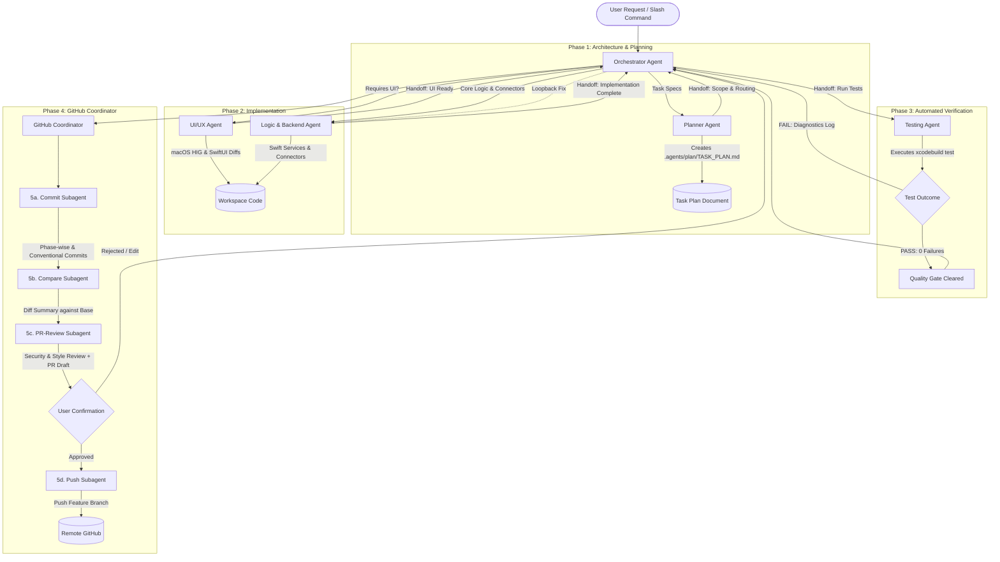

# OmniDesk Multi-Agent Development Workflow Architecture & Plan
**Document Location:** `.agents/plan/AGENT_SYSTEM_PLAN.md`  
**Status:** Architectural Specification & Scaffolding Plan (Plan Mode)  
**Author:** Senior Agent-Systems Architect  
**Target Assistant:** OmniDesk (Native macOS "Jarvis-style" Assistant App)  
**Created Date:** 2026-10-31  

---

## 1. Executive Summary & Architecture

To scale development on **OmniDesk** while preserving strict macOS platform safety, performance, and code quality, this plan establishes a **specialized, modular multi-agent development workflow**. 

Rather than relying on a single monolithic assistant attempting to research, design, code, test, and commit in one bloated context, the system decomposes every development task into a sequence of **single-responsibility subagents** coordinated by an **Orchestrator**.

### Key Architectural Pillars
1. **Strict Separation of Concerns**: Planners do not touch code; UI designers do not edit backend services; Testers never weaken test suites; Git pushers never bypass user confirmation.
2. **Stateless Handoff Contracts**: Communication between agents is mediated via a typed, file-persisted handoff contract (`OD-TASK-<ID>.json` / markdown payload) containing task status, plan references, files touched, open issues, and next-agent routing.
3. **Loopback & Quality Gate**: If the `Testing` agent detects failures, the `Orchestrator` returns control to `Logic & Backend` with failing diagnostic logs rather than proceeding to version control.
4. **Zero-Trust GitHub Safety**: Enforced guardrails prevent direct commits to `main`/`master`, force-pushes, secret leaks, and unreviewed pull requests.

---

## 2. Multi-Agent Topology & System Workflow



---

## 3. Agent Roster & Responsibility Matrix

| Agent Name | File Location | Primary Role | Allowed Tools | Forbidden Actions |
| :--- | :--- | :--- | :--- | :--- |
| **Orchestrator** | `.agents/agents/orchestrator.md` | Sequences agents, handles loops, user feedback | `define_subagent`, `invoke_subagent`, `manage_subagents`, `send_message`, `ask_question`, `read_file` | Modifying production code directly; force-pushing; bypassing tests |
| **Planner** | `.agents/agents/planner.md` | Translates task into `.agents/plan/<TASK>_PLAN.md` | `read_file`, `write_file` (plan files only), `search_web`, `ask_question` | Modifying production source code; running modifying terminal commands |
| **UI/UX** | `.agents/agents/ui.md` | Researches HIG, produces design notes, writes SwiftUI | `search_web`, `read_file`, `write_file`, `edit_file`, `run_command` (static preview) | Modifying backend/audio services; modifying tests; skipping HIG citations |
| **Logic & Backend** | `.agents/agents/logic-backend.md` | Implements connectors, services, models in small diffs | `read_file`, `write_file`, `edit_file`, `run_command` (build verification) | Weakening or deleting unit tests; altering UI layout unless planned |
| **Testing** | `.agents/agents/testing.md` | Runs `xcodebuild test`, adds tests, reports pass/fail | `read_file`, `write_file` (tests only), `edit_file` (tests only), `run_command` (`xcodebuild test`) | Modifying production source code; weakening test assertions to pass |
| **GitHub Coordinator** | `.agents/agents/github.md` | Coordinates version control sub-pipeline | `invoke_subagent`, `run_command` (git read), `ask_question`, `read_file` | Pushing without confirmation; force-pushing; committing on main branch |
| **GitHub Commit** | `.agents/agents/github-commit.md` | Stages changes file-wise, writes Conventional Commits | `run_command` (`git status`, `git add`, `git commit`), `read_file` | Staging secrets (`.xcconfig`, `.env`), batching unrelated files |
| **GitHub Push** | `.agents/agents/github-push.md` | Pushes branch to remote after explicit confirmation | `run_command` (`git push`, `git branch`), `ask_question` | Pushing directly to `main`/`master`; force-pushing (`-f`); unconfirmed push |
| **GitHub Compare** | `.agents/agents/github-compare.md` | Summarizes git diff against base branch | `run_command` (`git diff`, `git log`), `read_file` | Modifying git tree; staging or committing code |
| **GitHub PR Review** | `.agents/agents/github-pr-review.md` | Audits diff for bugs/secrets, drafts PR description | `run_command` (`git diff`), `read_file`, `write_file` (PR markdown draft) | Merging PRs; modifying branch history; approving insecure diffs |

---

## 4. Shared Handoff Contract Specification

To ensure seamless transitions between subagents without context window explosion or loss of state, every subagent consumes and emits a standardized **Handoff Contract**:

```yaml
handoff_contract:
  task_id: "OD-<YYYYMMDD>-<SHORT_SLUG>"
  task_name: "Short descriptive title of the feature or bugfix"
  plan_path: ".agents/plan/<TASK>_PLAN.md"
  current_agent: "orchestrator" # orchestrator | planner | ui | logic-backend | testing | github
  next_agent: "planner"
  status: "PLANNED" # PLANNED | IN_PROGRESS | BLOCKED | READY_FOR_TEST | TEST_PASSED | PR_DRAFTED | COMPLETED
  
  # Scope & Files Affected
  files_touched:
    - path: "relative/path/to/file.swift"
      action: "modified" # created | modified | deleted
      rationale: "Summary of change in this file"
      
  # Quality & Verification Status
  test_status: "NOT_RUN" # NOT_RUN | PASS | FAIL
  test_results:
    total_tests: 40
    passed: 40
    failed: 0
    failure_details: ""
    
  # Blockers & Open Items
  open_issues: []
  notes_for_next_agent: "Specific guidance or handoff context for the incoming agent"
```

---

## 5. Skills Alignment & Proposal

### 5.1 Existing Skills Map (`.agents/skills/*`)

| Agent | Required Existing Skills to Load | Purpose in Agent Workflow |
| :--- | :--- | :--- |
| **Orchestrator** | `compact` | Preserving session trajectory and executing summaries. |
| **Planner** | `compact`, `agy-customizations` | Reading project architecture and discovering system capabilities. |
| **UI/UX** | `macos-accessibility-automation`, `voice-task-pipeline` | Ensuring accessible UI components and audio waveform visualizer patterns. |
| **Logic & Backend** | `eventkit-calendar`, `macos-applescript-bridge`, `macos-security-tcc`, `security-scoped-bookmarks`, `swift-mcp-engine`, `voice-task-pipeline` | Full native capability suite for EventKit, Mail, TCC, Obsidian, MCP, and audio units. |
| **Testing** | `swift-test` (builtin) | Running unit tests and verifying strict concurrency and assertions. |
| **GitHub Coordinator** | `compact` | Extracting commit and PR history context. |

### 5.2 Proposed Missing Skills
The following skills are identified as missing and proposed for future addition:
1. **`macos-hig-ui`**: Guidelines, spacing tokens, typography, window vibrance/materials, and SF Symbols 6 patterns for macOS Human Interface Guidelines.
2. **`swift-testing`**: Modern Swift 6 Testing framework patterns (`@Suite`, `@Test`, `#expect`, traits, serialized execution) to augment XCTest.
3. **`github-pr-workflow`**: Conventional commit linting, automated secret pattern scanners (API keys, `.xcconfig`), and PR description templates.

---

## 6. GitHub Safety Rules & Pre-Flight Checklist

Every agent participating in version control must strictly follow these rules:
1. **Branch Protection**: Never commit or push directly to `main` or `master`. Always work on a feature branch (e.g., `feature/<task-name>`, `fix/<issue-name>`).
2. **No Force Pushing**: `git push --force` and `git push --force-with-lease` are strictly forbidden.
3. **No History Rewrites**: `git rebase -i` or destructive history commands on remote branches are forbidden.
4. **Mandatory User Confirmation**:
   - The user must explicitly confirm before the first push of any new branch to the remote repository.
   - The user must explicitly confirm before creating a Pull Request.
5. **Secret & Artifact Sanitization**:
   - Never stage or commit `Secrets.xcconfig`, `.env`, API keys, private tokens, or credentials.
   - Never commit build artifacts (`.build/`, `DerivedData/`, `*.xcresult`, `.DS_Store`).

---

## 7. Sample Task Walkthrough: "Add a Dark-Mode Toggle"

To demonstrate the contract and workflow in action, here is the complete end-to-end trace of adding a dark-mode toggle:

1. **Step 1: Orchestrator Ingestion**:
   - User prompt: *"Add a dark-mode toggle in settings and make it persist across restarts"*.
   - Orchestrator creates task `OD-20261031-darkmode` and invokes `Planner`.
2. **Step 2: Planner Execution**:
   - Planner inspects `Utilities/AppTheme.swift`, `Views/SettingsView.swift`, and `ViewModels/MainViewModel.swift`.
   - Planner writes `.agents/plan/DARK_MODE_TOGGLE_PLAN.md` defining scope, risks (color contrast in glassmorphic modals), affected files, and acceptance criteria.
   - Handoff contract emitted: `next_agent: "ui"`.
3. **Step 3: UI/UX Execution**:
   - UI/UX searches macOS HIG on "Appearance & Dark Mode".
   - Cites Apple Human Interface Guidelines for System Appearances.
   - Implements appearance segmented picker (`System`, `Light`, `Dark`) in `SettingsView.swift` using adaptive semantic tokens (`Color.omniCardSurface`, `Color.omniBorder`).
   - Handoff contract emitted: `next_agent: "logic-backend"`.
4. **Step 4: Logic & Backend Execution**:
   - Logic & Backend connects the picker to `@AppStorage("omni_app_theme")` in `ThemeManager` (`Utilities/AppTheme.swift`).
   - Ensures application window updates dynamically via `@Environment(\.colorScheme)`.
   - Compiles cleanly without warnings.
   - Handoff contract emitted: `next_agent: "testing"`.
5. **Step 5: Testing Execution**:
   - Testing discovers `OmniDeskTests/OmniDeskTests.swift`.
   - Adds unit test `testThemeManagerPersistence()` verifying that changing the theme stores the value and emits appropriate color schemes.
   - Executes `xcodebuild test -project OmniDesk.xcodeproj -scheme OmniDesk -destination 'platform=macOS' -only-testing:OmniDeskTests`.
   - Outcome: `** TEST SUCCEEDED **` (41 tests passed).
   - Handoff contract emitted: `test_status: "PASS"`, `next_agent: "github"`.
6. **Step 6: GitHub Coordinator Execution**:
   - `github-commit` stages `Utilities/AppTheme.swift` and commits `feat(theme): add persistent appearance mode toggle`. Stages `OmniDeskTests.swift` and commits `test(theme): add persistence unit test`.
   - `github-compare` summarizes diff (+42 lines, -6 lines, 0 secrets).
   - `github-pr-review` reviews diff for accessibility contrast, drafts PR markdown description.
   - `github-push` prompts user: *"Ready to push feature/dark-mode-toggle to origin? [Yes/No]"*. User confirms. Branch pushed!

---

## 8. Open Questions & Architectural Decisions for User

> [!IMPORTANT]
> **Decision 1: Agent Execution Runtime**
> Should subagents be defined strictly as markdown prompt specifications in `.agents/agents/*.md` for the main Antigravity agent to read and follow when dispatching subagents (via `define_subagent` and `invoke_subagent`), or would you also like a lightweight Swift CLI orchestrator harness?
> *(Recommended: Markdown prompt specifications in `.agents/agents/*.md` natively integrated with Antigravity subagent tools).*

> [!IMPORTANT]
> **Decision 2: Sub-agent Granularity for GitHub Coordinator**
> The GitHub Coordinator is specified with 4 granular subagents (`commit`, `push`, `compare`, `pr-review`). Do you prefer each as an independent `.agents/agents/github-<subtask>.md` file (maximum modularity, exactly under 100 lines), or bundled within `github.md`?
> *(Recommended: 4 separate subagent files under `.agents/agents/` for clean single-responsibility).*

> [!NOTE]
> **Decision 3: Proposed Skills Creation**
> Three missing skills were identified: `macos-hig-ui`, `swift-testing`, and `github-pr-workflow`. Should we schedule the creation of these skills in a subsequent phase after the agent scaffolding is committed?
