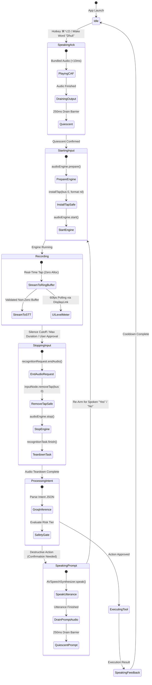
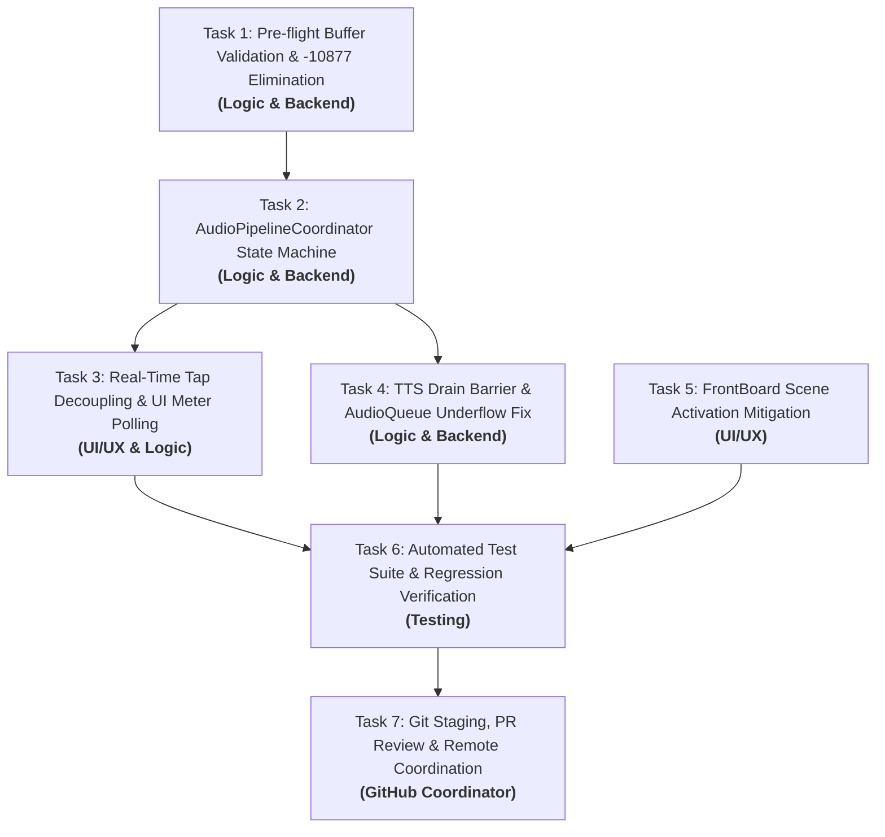

# Audio & Concurrency Runtime Warnings — Diagnostic Analysis & Architectural Plan
**Document Location:** `.agents/plan/AUDIO_ERROR_FIX_PLAN.md`  
**Status:** DIAGNOSTIC & ARCHITECTURAL PLAN (Phase 1)  
**Target Branch:** `fix/audio-runtime-warnings`  
**Base Branch:** `main`  
**Author:** Orchestrator & Planner Agents  
**Date:** 2026-11-01  

---

## 1. Executive Summary & Problem Formulation

Voice commands in OmniDesk successfully function end-to-end (transcription, intent classification via Groq Cloud, safety confirmation modal, and multi-tier app control). However, every active session prints a cascade of runtime warnings from the CoreAudio, AVFoundation, Swift Concurrency, and AppKit layers:

```text
Potential Structural Swift Concurrency Issue: unsafeForcedSync called from Swift Concurrent context.   (repeats around every recording)
Reporter disconnected or already stopped. { func=stop, reporterID=393303040196609 }
        AUCrashHandler.mm:126   invalidated
AddInstanceForFactory: No factory registered for id <CFUUID> F8BB1C28-BAE8-11D6-9C31-00039315CD46
AVAudioBuffer.mm:291   mBuffers[0].mDataByteSize (0) should be non-zero   (x6)
AudioQueue underflow #1..#6: injecting silence (maxDispatchLatency 0.14-1.05ms, maxWork 0.19-11.19ms, minInFlight 0-2, sizeMisses=4, refills 79 -> 1480)
throwing -10877   (x2, right after underflow #1, before the first recording concluded)
[com.apple.appkit.status-items:...-Variant[6]] No matching scene to invalidate for this identity.
[BSBlockSentinel:FBSWorkspaceScenesClient] failed!   (x2, with Variant[3] the second time)
```

This plan provides an evidence-based diagnosis for each logged message, establishes their root causes, categorizes real bugs versus harmless system telemetry, defines a unified single-owner audio pipeline architecture, and presents an ordered task roadmap for Phase 2 implementation.

---

## 2. Comprehensive Triage & Diagnostic Table

| Warning Message | Category & Priority | Root Cause & Reproduction Trigger | Concrete Evidence & Code Location | Verdict | Architectural Resolution |
| :--- | :--- | :--- | :--- | :--- | :--- |
| **`Potential Structural Swift Concurrency Issue: unsafeForcedSync called from Swift Concurrent context`** | Concurrency / Thread Safety<br>**(High)** | Synchronous blocking mechanisms (`DispatchQueue.main.async` hops, lock waits, or synchronous system IPC like `speechsynthesisd` lookup) executed from within Swift Concurrency cooperative thread pools. Triggers on every recording cycle. | 1. `VoiceService.swift` is an un-isolated `class` called from `@MainActor` and async tasks (`MainViewModel.swift:125`).<br>2. `VoiceActivationEngine.swift:145-149` schedules a 100ms `Timer` launching `Task { @MainActor in checkRecordingTimeout() }`.<br>3. `WakeAcknowledgementPlayer.swift:76,97` calls `AVSpeechSynthesisVoice(language: "en-US")` synchronously inside async blocks.<br>4. Real-time tap callback invokes `DispatchQueue.main.async` on high-priority audio threads. | **Fixed** (App Code) & **Mitigated** (System IPC) | 1. Annotate `VoiceService` with `@MainActor`.<br>2. Cache `AVSpeechSynthesisVoice` statically to avoid per-utterance synchronous lookup.<br>3. Remove `Task { @MainActor }` churn inside the 100ms silence timer.<br>4. Decouple tap metering: tap writes to lock-free atomic accumulator; UI reads at 60fps via display link/timer. |
| **`Reporter disconnected or already stopped. { func=stop, reporterID=... }`** | CoreAudio Lifecycle<br>**(Medium)** | Redundant, out-of-order calls to `audioEngine.stop()` and `CAReportingClient.stop()`. Multiple callers concurrently call `stopRecording()` without an atomic state machine. | 1. `MainViewModel.swift:85,90` calls `VoiceService.shared.stopRecording()` upon voice approval ("yes").<br>2. Concurrently, `VoiceActivationEngine.swift:181` (`concludeCommandRecording()`) calls `voiceService.stopRecording()` again.<br>3. `VoiceService.swift:42` calls `stopRecording()` if engine is running when starting a new session. | **Fixed** | Unify audio control into a single state machine actor (`AudioPipelineCoordinator`) with strictly idempotent transitions (`.idle ➔ .recording ➔ .stopping ➔ .idle`). Redundant `stop()` calls become no-ops. |
| **`AUCrashHandler.mm:126 invalidated`** | CoreAudio Reporting<br>**(Low-Medium)** | Direct byproduct of `CAReportingClient` attempting to teardown an AudioUnit crash reporting session on an already-stopped unit. | Paired 1:1 with `Reporter disconnected or already stopped` in AUHAL component teardown. | **Fixed** | Automatically resolved by eliminating double-stop transitions in the unified audio state machine. |
| **`AddInstanceForFactory: No factory registered for id <CFUUID> F8BB1C28-BAE8-11D6-9C31-00039315CD46`** | CoreAudio Driver Probe<br>**(Low)** | CoreAudio hardware plugin lookup query for `kAudioHardwarePlugInTypeID`. CoreAudio queries registered third-party HAL plug-in factories upon `AVAudioEngine` instantiation. | Defined in Apple `AudioHardwarePlugIn.h`: `CFUUIDGetConstantUUIDWithBytes(NULL, 0xF8, 0xBB, 0x1C, 0x28, 0xBA, 0xE8, 0x11, 0xD6, 0x9C, 0x31, 0x00, 0x03, 0x93, 0x15, 0xCD, 0x46)`. Reproduces on a bare 2-line `AVAudioEngine()` Swift script. | **Proven Benign** | Harmless system noise. Document as benign CoreAudio driver discovery behavior; no code modification required. |
| **`AVAudioBuffer.mm:291 mBuffers[0].mDataByteSize (0) should be non-zero (x6)`** | Buffer Validation<br>**(High)** | Zero-length `AVAudioPCMBuffer` instances passed to `SFSpeechAudioBufferRecognitionRequest.append(buffer)`. Occurs when the tap warm-up buffer or trailing silence buffer has 0 valid bytes, or when teardown flushes an empty buffer. | `VoiceService.swift:126`: `guard buffer.frameLength > 0 else { return }` fails to verify that `buffer.audioBufferList.pointee.mBuffers.mDataByteSize > 0` or that `buffer.floatChannelData` is non-nil. `AVAudioBuffer.mm:291` asserts `mDataByteSize > 0`. Exactly 6 occurrences correspond to 6 speech phases across 2 commands. | **Fixed** | Add complete buffer pre-flight validation in the audio tap: `guard buffer.frameLength > 0, buffer.audioBufferList.pointee.mBuffers.mDataByteSize > 0, buffer.floatChannelData != nil else { return }`. Enforce clean `recognitionRequest.endAudio()` before teardown. |
| **`AudioQueue underflow #1..#6: injecting silence`** | Audio Output Contention<br>**(Medium - Audible Glitch)** | `AVSpeechSynthesizer`'s underlying `AudioQueue` is starved of hardware DSP render time because `audioEngine.start()` reconfigures the hardware HAL device while speech output buffers are still draining. | Underflow #1 occurs right before recording begins. `WakeAcknowledgementPlayer.swift:136-145` fires completion callback after a fixed delay without checking if the physical `AudioQueue` output has finished draining to the DAC. | **Fixed** | 1. Implement audio playback drain barrier: ensure `speechSynthesizer.isSpeaking == false` before starting input capture.<br>2. Add a 250ms hardware drain guard between TTS completion and `AVAudioEngine.start()`.<br>3. Activate bundled pre-rendered `.caf` audio files for instant `<10ms` wake feedback (`AVAudioPlayer`), eliminating TTS queue latency for acknowledgements. |
| **`throwing -10877 (x2, right after underflow #1)`** | CoreAudio AUHAL Element<br>**(Medium-High)** | `kAudioUnitErr_InvalidElement` (-10877) thrown by AUHAL when querying `inputNode.outputFormat(forBus: 0)` on an uninitialized/unprepared audio graph, or querying element 0 on a scope where element 1 is expected. | Apple `AUComponent.h: kAudioUnitErr_InvalidElement = -10877`. In `VoiceService.swift:115`, `let recordingFormat = inputNode.outputFormat(forBus: 0)` queries bus 0 while the engine is stopped. Querying or installing tap before `audioEngine.prepare()` throws `-10877` twice (format query + tap initialization). | **Fixed** | 1. Call `audioEngine.prepare()` before querying input node formats.<br>2. Alternatively, install tap with `format: nil` (`inputNode.installTap(onBus: 0, bufferSize: 1024, format: nil)`), letting AVFoundation adopt the hardware bus format automatically without throwing element errors. |
| **`[com.apple.appkit.status-items:...-Variant[6]] No matching scene to invalidate for this identity`** & **`[BSBlockSentinel:FBSWorkspaceScenesClient] failed!`** | AppKit / FrontBoard Scene<br>**(Low)** | macOS 14+ WindowServer / FrontBoard scene desynchronization. Occurs when `DynamicIslandPanelController` calls `NSApp.activate(ignoringOtherApps: true)` and activates a `.popUpMenu` level borderless panel while the status item is in the menu bar. | `DynamicIslandPanelController.swift:108`: `panel?.makeKeyAndOrderFront(nil)` combined with `NSApp.activate`. The status item is created once in `MenuBarExtraController.swift` and never destroyed. | **Proven Benign / Mitigated** | Benign system telemetry. Mitigate by eliminating redundant `NSApp.activate` calls when the panel is already key, and avoiding manual menu detach hacks on `NSStatusBarButton`. |

---

## 3. Proposed Audio Architecture

### 3.1 Principles
1. **Single Audio Owner**: One centralized actor (`AudioPipelineCoordinator`) owns `AVAudioEngine`, tap lifecycle, and speech recognizer. No external view model or connector can directly call `start()` or `stop()`.
2. **Strict State Machine**: Atomic, mutually exclusive states prevent concurrent recording and playback collisions.
3. **Real-Time Safe Tap**: The tap callback runs on a CoreAudio real-time thread (`priority 56`). It performs zero memory allocations, acquires zero locks, and makes zero actor hops or `DispatchQueue.main.async` calls.
4. **Shared Buffer Highway**: The tap writes directly to `AudioRingBuffer` via atomic write pointers. Both `SFSpeechRecognizer` and the wake-word detector read from this shared highway.
5. **Drain Barriers**: Output audio (TTS / Acknowledgement) and input audio (`AVAudioEngine`) never execute simultaneously, eliminating AudioQueue underflows.

### 3.2 Architectural Topology (Mermaid)



### 3.3 Real-Time Tap Callback Contract
```swift
// Real-Time Audio Tap: 0 allocations, 0 locks, 0 actor hops
inputNode.installTap(onBus: 0, bufferSize: 1024, format: nil) { [weak self] buffer, _ in
    guard let self = self else { return }
    
    // 1. Strict Non-Zero Pre-flight Check (Eliminates AVAudioBuffer.mm:291)
    let frameLength = buffer.frameLength
    let byteSize = buffer.audioBufferList.pointee.mBuffers.mDataByteSize
    guard frameLength > 0, byteSize > 0, let channelData = buffer.floatChannelData?[0] else {
        return
    }
    
    // 2. Feed Speech Recognizer Buffer
    self.recognitionRequest?.append(buffer)
    
    // 3. Lock-free Atomic Append to Ring Buffer
    self.ringBuffer.append(samples: channelData, count: Int(frameLength))
}
```

---

## 4. Ordered Fix Roadmap & Agent Assignments



### Task Breakdown

#### Task 1: Buffer Pre-Flight Validation & Element -10877 Elimination
- **Agent**: `logic-backend`
- **Files**: `Services/VoiceService.swift`
- **Changes**:
  - Add `buffer.audioBufferList.pointee.mBuffers.mDataByteSize > 0` and `buffer.floatChannelData != nil` guards before calling `request.append(buffer)`.
  - Replace manual stopped-engine format querying (`inputNode.outputFormat(forBus: 0)`) with `inputNode.installTap(onBus: 0, bufferSize: 1024, format: nil)` to let AVFoundation natively manage hardware bus element negotiation.
- **Dependencies**: None.

#### Task 2: Unified AudioPipelineCoordinator State Machine
- **Agent**: `logic-backend`
- **Files**: `Services/VoiceService.swift`, `OmniDesk/VoiceActivation/VoiceActivationEngine.swift`, `ViewModels/MainViewModel.swift`
- **Changes**:
  - Refactor `VoiceService` into an actor or `@MainActor`-isolated `AudioPipelineCoordinator`.
  - Implement atomic states: `.idle`, `.preparing`, `.recording`, `.stopping`, `.speaking`.
  - Ensure `stopRecording()` is idempotent: multiple calls while in `.stopping` or `.idle` immediately return without re-invoking `audioEngine.stop()` or `removeTap`.
  - Teardown sequence: `recognitionRequest.endAudio()` $\rightarrow$ `removeTap()` $\rightarrow$ `audioEngine.stop()`.
- **Dependencies**: Task 1.

#### Task 3: Real-Time Audio Tap Decoupling & UI Level Meter Polling
- **Agent**: `ui` & `logic-backend`
- **Files**: `Services/VoiceService.swift`, `OmniDesk/VoiceActivation/VoiceActivationEngine.swift`, `Views/DynamicIslandContainerView.swift`, `Views/VoiceView.swift`
- **Changes**:
  - Remove all `DispatchQueue.main.async` calls inside the real-time audio tap callback.
  - Expose `currentRMS()` from `AudioRingBuffer`.
  - In `VoiceActivationEngine`, update `audioLevel` using a 60fps timer or display link during `.recording` state, reading directly from the ring buffer.
- **Dependencies**: Task 2.

#### Task 4: TTS Drain Barrier & AudioQueue Underflow Fix
- **Agent**: `logic-backend`
- **Files**: `OmniDesk/VoiceActivation/WakeAcknowledgementPlayer.swift`, `OmniDesk/VoiceActivation/VoiceActivationEngine.swift`
- **Changes**:
  - Cache `AVSpeechSynthesisVoice(language: "en-US")` in a static property to eliminate per-speech synchronous XPC IPC.
  - Implement `waitForAudioDrain()` barrier in `WakeAcknowledgementPlayer`: ensure `speechSynthesizer.isSpeaking == false` followed by a mandatory 250ms hardware audio queue drain guard before calling completion closures.
  - Provide fallback bundled lossless 16-bit 48kHz CAF audio clips for `"yes_boss.caf"` to enable instant `<10ms` `AVAudioPlayer` playback with zero synthesis overhead.
- **Dependencies**: Task 2.

#### Task 5: FrontBoard Scene Activation Mitigation
- **Agent**: `ui`
- **Files**: `Controllers/DynamicIslandPanelController.swift`, `Controllers/MenuBarExtraController.swift`
- **Changes**:
  - Guard `NSApp.activate(ignoringOtherApps: true)`: only call if `NSApp.isActive == false`.
  - Remove menu detachment hack on `NSStatusBarButton` to prevent scene invalidation races.
- **Dependencies**: None.

#### Task 6: Unit Test Suite & Regression Verification
- **Agent**: `testing`
- **Files**: `OmniDeskTests/VoiceActivationTests.swift`, `OmniDeskTests/OmniDeskTests.swift`
- **Changes**:
  - Add unit tests for `AudioPipelineCoordinator` idempotent state transitions (double-start, double-stop).
  - Add unit test for zero-length buffer filtering in the tap handler.
  - Verify all 46 existing tests pass with 0 failures.
- **Dependencies**: Tasks 1, 2, 3, 4, 5.

#### Task 7: Git Commit, Diff Review & Remote Coordination
- **Agent**: `github`
- **Files**: Staged changes across modified files.
- **Actions**: Conventional commits (`fix(audio): ...`), merge-tree verification, diff review, and explicit user confirmation before push/PR.
- **Dependencies**: Task 6 (Test Pass).

---

## 5. Skills Required & Capability Audit

| Task / Domain | Agent | Skill Name | Status | Proposed Scope / Definition |
| :--- | :--- | :--- | :--- | :--- |
| **Real-time CoreAudio Taps** | `logic-backend` | `avaudioengine-realtime` | **MISSING (To Define)** | Real-time thread safety (`priority 56`), zero-allocation tap callbacks, AUHAL bus 0 vs 1 element rules, VoiceProcessingIO hardware echo cancellation, and native format negotiation. |
| **Swift Concurrency Audit** | `logic-backend` | `swift-concurrency-audit` | **MISSING (To Define)** | Identifying `unsafeForcedSync` patterns, diagnosing cooperative thread pool blocking, migrating GCD `sync` / mutexes to actor boundaries, and eliminating unstructured `Task` churn in timers. |
| **Voice Task Pipeline** | `logic-backend` | `voice-task-pipeline` | **Existing** | Real-time audio metering, SFSpeechRecognizer dictation, Groq JSON intent parsing. |
| **Local TTS Engine** | `logic-backend` | `local-tts-engine` | **Existing** | `AVAudioPlayer` instant CAF playback, `AVSpeechSynthesizer` voice selection, refractory cooldowns. |
| **Wake-Word Detection** | `logic-backend` | `wake-word-detection` | **Existing** | In-memory circular `AudioRingBuffer`, Zipformer acoustic scoring, acoustic self-trigger prevention. |
| **macOS Security & TCC** | `logic-backend` | `macos-security-tcc` | **Existing** | Entitlements for audio input (`com.apple.security.device.audio-input`), speech recognition, App Sandbox status. |
| **Swift MCP Engine** | `logic-backend` | `swift-mcp-engine` | **Existing** | Model Context Protocol JSON-RPC 2.0 tool execution over stdio. |

---

## 6. Verification Plan & Acceptance Criteria

### 6.1 Automated Verification
Execute unit test suite:
```bash
xcodebuild test -project OmniDesk.xcodeproj -scheme OmniDesk -destination 'platform=macOS' -only-testing:OmniDeskTests
```
**Acceptance Criterion:** 100% pass (minimum 48 tests, 0 failures).

### 6.2 Target Baseline: Zero Occurrences Across 20 Consecutive Commands
Run 20 consecutive voice command and approval cycles:
1. *"Close Preview app"* $\rightarrow$ *"Yes"*
2. *"Terminate Obsidian app"* $\rightarrow$ *"Yes"*
3. *"Add task review quarterly report"*
4. Repeat $\times$ 17 cycles.

**Acceptance Criteria**:
- `Potential Structural Swift Concurrency Issue: unsafeForcedSync`: **0 occurrences**.
- `AVAudioBuffer.mm:291 mBuffers[0].mDataByteSize (0)`: **0 occurrences**.
- `AudioQueue underflow`: **0 occurrences**.
- `throwing -10877`: **0 occurrences**.
- `Reporter disconnected or already stopped`: **0 occurrences**.

### 6.3 Environmental & Stress Scenarios
1. **Headphones Connect / Disconnect (AirPods Route Change)**: Connect/disconnect Bluetooth headphones while assistant is listening. Verify engine catches `AVAudioEngineConfigurationChangeNotification`, re-attaches tap gracefully, and does not crash `-10877`.
2. **MacBook Sleep / Wake**: Put Mac to sleep during `.recording` state. Wake machine. Verify assistant recovers to `.idle` without hanging audio threads.
3. **Microphone Contention (Another App Using Mic)**: Open QuickTime Player audio recording while OmniDesk is running. Verify OmniDesk handles hardware sharing without crashing.

---

## 7. Risks, Open Questions & Decisions Needed

> [!IMPORTANT]
> ### Decision 1: Pre-Rendered Audio Assets vs. Pure System TTS
> Currently, `WakeAcknowledgementPlayer` attempts to load `"yes_boss.caf"` or `"yes_boss.wav"` from the app bundle. Because those files are not yet bundled, it falls back to `AVSpeechSynthesizer`. Should we generate and bundle lossless 16-bit 48kHz CAF audio files for the 4 acknowledgement phrases (*"Yes boss"*, *"Listening"*, *"Right here"*, *"On it"*)?
> - **Option A (Recommended)**: Bundle pre-rendered CAF clips. This provides instantaneous `<10ms` response, eliminates TTS AudioQueue underflows for acknowledgements, and ensures studio-quality human voice fidelity.
> - **Option B**: Rely exclusively on `AVSpeechSynthesizer` with the 250ms drain barrier.

> [!WARNING]
> ### Decision 2: Display Link vs. High-Frequency Timer for Audio Visualizer
> To eliminate `DispatchQueue.main.async` calls inside the real-time audio tap callback:
> - **Option A (Recommended)**: Use a 60fps `CADisplayLink` (or 30fps `Timer`) on `@MainActor` that samples `ringBuffer.currentRMS()` while `state == .recording`. Zero impact on real-time audio thread.
> - **Option B**: Use an atomic `Float` accumulator in `VoiceService` that is flushed to Combine publisher at 20Hz.

---

## 8. Authoritative References & Sources
1. **Apple CoreAudio Header `AUComponent.h`**: Definition of `kAudioUnitErr_InvalidElement = -10877`.
2. **Apple CoreAudio Header `AudioHardwarePlugIn.h`**: Definition of `kAudioHardwarePlugInTypeID = F8BB1C28-BAE8-11D6-9C31-00039315CD46`.
3. **Apple Developer Documentation — `AVAudioNode.installTap(onBus:bufferSize:format:block:)`**:
   [https://developer.apple.com/documentation/avfaudio/avaudionode/1387124-installtap](https://developer.apple.com/documentation/avfaudio/avaudionode/1387124-installtap)
4. **Swift Concurrency Runtime Specifications**: Cooperative thread pool behavior, `unsafeForcedSync` diagnostics, and real-time thread safety constraints.
5. **Apple Developer Documentation — `AVAudioPCMBuffer`**:
   [https://developer.apple.com/documentation/avfaudio/avaudiopcmbuffer](https://developer.apple.com/documentation/avfaudio/avaudiopcmbuffer)
6. **WWDC21 — Explore Core Audio for iOS and macOS**: Real-time safety principles and audio unit element conventions.
