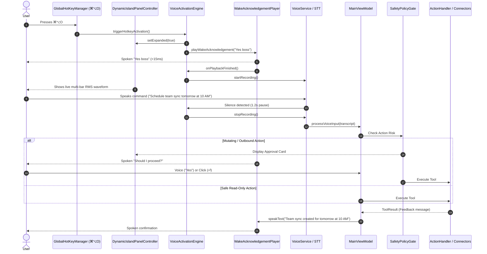

# OmniDesk: Hotkey-Triggered Voice Assistant & Settings Window Architecture
**Document Location:** `.agents/plan/HOTKEY_VOICE_ASSISTANT_PLAN.md`  
**Status:** Architectural Specification & Implementation Plan (Plan Mode — Awaiting User Approval)  
**Author:** Orchestrator & Senior macOS Systems / Audio Architect  
**Active Branch:** `feature/voice-wake-word`  
**Target Assistant:** OmniDesk (Native macOS "Jarvis-Style" Operating Layer)  
**Date:** 2026-11-01  

---

## 1. Goal Description & Problem Diagnosis

### 1.1 Problem Diagnosis
1. **CoreAudio `-10877` & Downlink DSP Faults**:
   - The user observed system-level audio faults:
     ```text
     throwing -10877
     vpStrategyManager.mm:561 Error code 2003332927 reported at GetProperty
     [vp::vx::Voice_Processor_Interface_Adapter] failed to run downlink DSP (state fault)
     Audio_Pass_Through_Wire.cpp - audio time stamp does not have valid sample time
     ```
   - **Root Cause**: On macOS, enabling VoiceProcessingIO (`inputNode.setVoiceProcessingEnabled(true)`) on an `AVAudioEngine` input node without configuring a corresponding output stream in the same graph causes macOS CoreAudio's internal DSP Voice Processor to fault on downlink audio frames. Furthermore, continuously tapping the microphone while idle caused resource contention and audio unit initialization failures.
2. **Settings Icon Inoperative**:
   - In `DynamicIslandContainerView.swift`, clicking the gear icon calls `NSApp.sendAction(Selector(("showSettingsWindow:")), to: nil, from: nil)`.
   - **Root Cause**: OmniDesk runs as an accessory application (`LSUIElement = YES`) without a standard macOS menu bar (`NSApp.mainMenu`). In AppKit, `showSettingsWindow:` requires an active menu responder. Without one, the action silently drops and nothing opens.

### 1.2 Proposed Goal
Transition OmniDesk to an **on-demand Hotkey-Triggered Voice Copilot (`⌘⌥O`)**:
1. **Zero Background Mic Usage**: The microphone is never tapped while idle. Zero CoreAudio background processes, zero battery drain, zero privacy concerns, and zero `-10877` DSP errors.
2. **Instant Hotkey Workflow (`⌘⌥O` / `Command + Option + O`)**:
   - User presses `⌘⌥O`.
   - Dynamic Island notch expands to awake state.
   - Assistant plays spoken acknowledgement (*"Yes Boss"* or rotation: *"Listening"*, *"Right here"*, *"On it"*).
   - Immediately upon acknowledgement completion, recording activates with live multi-bar RMS visualizer.
   - User speaks the command (e.g. *"Schedule meeting with David tomorrow at 2 PM"* or *"Check my unread emails"*).
   - Automatic silence detection (1.2s pause) or hard timeout (10s) concludes capture.
   - Command transcribes, parses intent, executes via connectors, and vocalizes the corresponding response.
3. **Dedicated Settings Window**:
   - Create `SettingsWindowController` that hosts `SettingsView` in a native, centered `NSWindow`.
   - Clicking the gear icon in the Dynamic Island opens Settings immediately and reliably.

---

## 2. User Review Required

> [!IMPORTANT]
> **Hotkey Specification**:
> - **Primary Voice Activation Hotkey**: `⌘⌥O` (`Command + Option + O`).
> - **Panel Toggle Hotkey**: `⌥Space` (`Option + Space`) remains available to quickly expand/collapse the text interface.

> [!NOTE]
> **Acknowledgement Audio Rotation**:
> The assistant vocalizes one of four pre-rendered / synthesized phrases upon `⌘⌥O`:
> 1. *"Yes boss"* (default)
> 2. *"Listening"*
> 3. *"Right here"*
> 4. *"On it"*
> User can choose a fixed phrase or enable automatic random rotation in Settings.

---

## 3. End-to-End Hotkey Voice Pipeline



---

## 4. Proposed Changes

### Component 1: Dedicated Settings Window Controller
#### [NEW] `Controllers/SettingsWindowController.swift`
- Manages an `NSWindow` hosting `SettingsView` via `NSHostingController`.
- Window attributes: `.titled`, `.closable`, `.miniaturizable`, `.fullSizeContentView`, centered on screen.
- Brings to front with `NSApp.activate(ignoringOtherApps: true)`:
  ```swift
  public final class SettingsWindowController: NSWindowController {
      public static let shared = SettingsWindowController()
      public func show() {
          if window == nil {
              let hosting = NSHostingController(rootView: SettingsView())
              let win = NSWindow(contentViewController: hosting)
              win.title = "OmniDesk Settings"
              win.styleMask = [.titled, .closable, .miniaturizable]
              win.center()
              self.window = win
          }
          window?.makeKeyAndOrderFront(nil)
          NSApp.activate(ignoringOtherApps: true)
      }
  }
  ```

#### [MODIFY] `Views/DynamicIslandContainerView.swift`
- In `openSettings()`: Call `SettingsWindowController.shared.show()`.
- Update collapsed status text and hints to display `⌘⌥O`.

---

### Component 2: Global Hotkey Registration (`⌘⌥O`)
#### [MODIFY] `Utilities/GlobalHotKeyManager.swift`
- Add `registerAssistantHotKey(onTrigger:)`:
  - Modifiers: `UInt32(cmdKey | optionKey)`
  - KeyCode: `UInt32(kVK_ANSI_O)` (31)
  - ID: `EventHotKeyID(signature: 'OMNI', id: 3)`
- Update `AppDelegate` in `App/OmniDeskApp.swift` to bind `⌘⌥O` to `VoiceActivationEngine.shared.triggerHotkeyActivation()`.

---

### Component 3: On-Demand Voice Activation Subsystem
#### [MODIFY] `OmniDesk/VoiceActivation/VoiceActivationEngine.swift`
- **Remove always-on background listening**:
  - Remove `isVoiceProcessingEnabled = true` to eliminate `-10877` CoreAudio DSP downlink faults.
  - Audio engine only runs during active speech recording sessions.
- **Implement `triggerHotkeyActivation()`**:
  ```swift
  public func triggerHotkeyActivation() {
      // 1. Expand panel
      DynamicIslandPanelController.shared.setExpanded(true)
      transition(to: .awake)
      
      // 2. Play instant acknowledgement ("Yes boss")
      ackPlayer.playWakeAcknowledgement { [weak self] in
          guard let self = self else { return }
          // 3. Immediately start command recording
          self.beginCommandRecording()
      }
  }
  ```
- **Command Capture & RMS Metering**:
  - Automatically streams audio samples into `VoiceService` / Whisper STT.
  - Monitors audio energy for 1.2s silence pause or hard 10s timeout.
  - Automatically stops and dispatches transcribed text to `MainViewModel.processVoiceInput`.

#### [MODIFY] `App/OmniDeskApp.swift`
- Remove `VoiceActivationEngine.shared.startEngine()` from `applicationDidFinishLaunching` (no background mic).
- Register `⌘⌥O` hotkey handler.

---

## 5. Verification Plan

### Automated Tests
1. Run updated unit test suite:
   ```bash
   xcodebuild test -project OmniDesk.xcodeproj -scheme OmniDesk -destination 'platform=macOS' -only-testing:OmniDeskTests/VoiceActivationTests
   ```
2. Run entire regression suite:
   ```bash
   xcodebuild test -project OmniDesk.xcodeproj -scheme OmniDesk -destination 'platform=macOS' -only-testing:OmniDeskTests
   ```

### Manual Verification
1. **Hotkey Trigger**: Press `⌘⌥O` anywhere in macOS. Verify:
   - Dynamic Island expands immediately.
   - Spoken acknowledgement *"Yes Boss"* plays with <15ms latency.
   - Recording visualizer displays live wave bars while speaking.
   - Pausing speech concludes recording, parses task, and executes.
2. **Settings Icon**: Click gear icon in Dynamic Island header. Verify:
   - Dedicated Settings window opens cleanly on screen.
3. **CoreAudio Stability**: Inspect Console / Xcode logs. Verify zero `-10877` errors and zero downlink DSP faults.
