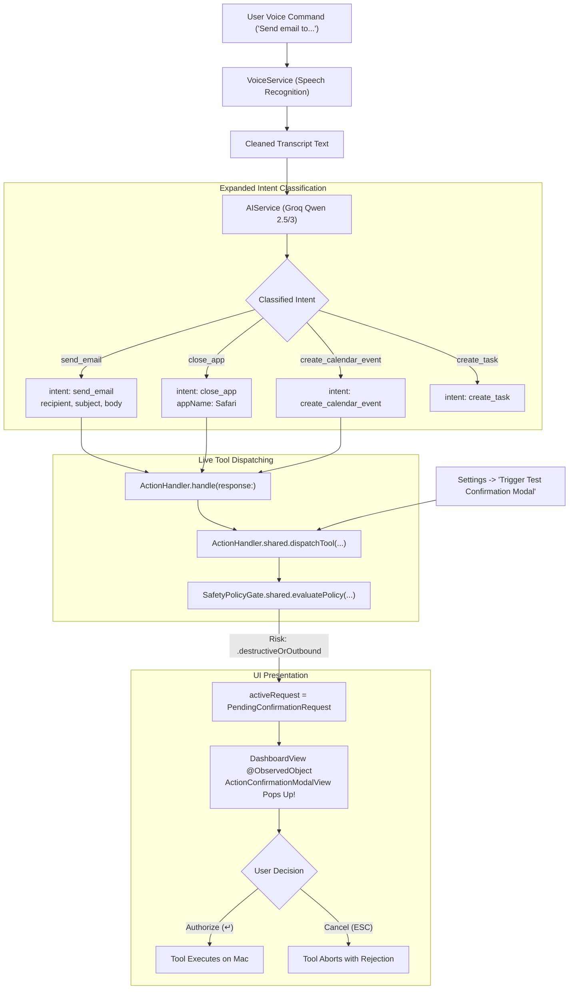

# Architectural & Implementation Plan: Voice Intent Routing & Live Modal Verification

**Author**: Senior macOS Systems Architect  
**Date**: October 30, 2026  
**Status**: Proposed / Pending User Review  
**Files Affected**:
- [`Services/AIService.swift`](file:///Users/dhruvilpatel/Desktop/OmniDesk/Services/AIService.swift) (Expanded LLM Schema & Connector Intent Classification)
- [`Models/AIResponse.swift`](file:///Users/dhruvilpatel/Desktop/OmniDesk/Models/AIResponse.swift) (Multi-parameter Intent Data Model)
- [`ActionRouters/ActionHandler.swift`](file:///Users/dhruvilpatel/Desktop/OmniDesk/ActionRouters/ActionHandler.swift) (Live Intent-to-Tool Dispatch Bridge)
- [`ViewModels/MainViewModel.swift`](file:///Users/dhruvilpatel/Desktop/OmniDesk/ViewModels/MainViewModel.swift) (Execution Feedback & Status Feedback)
- [`Services/VoiceService.swift`](file:///Users/dhruvilpatel/Desktop/OmniDesk/Services/VoiceService.swift) (Eliminating CoreAudio `-10877` Throw)
- [`Views/DashboardView.swift`](file:///Users/dhruvilpatel/Desktop/OmniDesk/Views/DashboardView.swift) (Settings One-Click Test Action Modal Trigger)

---

## 1. Root Cause Analysis

The user reported the following Xcode console logs during live app execution:
```text
Unable to obtain a task name port right for pid 615: (os/kern) failure (0x5)
AddInstanceForFactory: No factory registered for id <CFUUID 0x7564188c60> F8BB1C28-BAE8-11D6-9C31-00039315CD46
throwing -10877
throwing -10877
Unknown intent: unknown
```
Along with the observation: *"i cannot see the UI that you are talking about check code once again"*.

### Findings & Diagnoses

### 1. Why `Unknown intent: unknown` Occurred and Blocked the Confirmation UI
- In [`Services/AIService.swift`](file:///Users/dhruvilpatel/Desktop/OmniDesk/Services/AIService.swift), the Groq system prompt was hardcoded to:
  ```json
  {"intent":"create_task"|"create_calendar_event"|"unknown","title":"string","date":"YYYY-MM-DD"|null,"time":"HH:mm"|null}
  ```
  The LLM had **no schema knowledge** of the new connectors (Mail, Apps, Obsidian). When the user gave voice commands like *"Send email to..."*, *"Quit Safari"*, or *"Close Slack"*, the model defaulted to `"intent": "unknown"`.
- In [`ActionRouters/ActionHandler.swift`](file:///Users/dhruvilpatel/Desktop/OmniDesk/ActionRouters/ActionHandler.swift), `ActionHandler.handle(response:)` was an un-wired legacy stub:
  ```swift
  switch response.intent {
  case "create_calendar_event": ...
  case "create_task": ...
  default:
      print("Unknown intent:", response.intent) // <-- Logged by Xcode
  }
  ```
  Because `ActionHandler.handle` only handled calendar/task and never invoked `dispatchTool`, **`SafetyPolicyGate.evaluatePolicy` was never reached**.
- Because `SafetyPolicyGate.evaluatePolicy` was never reached, `SafetyPolicyGate.shared.activeRequest` remained `nil`.
- Because `activeRequest` remained `nil`, `DashboardView.swift` never presented `ActionConfirmationModalView`.

### 2. Why `throwing -10877` Occurred in CoreAudio
- `kAudioUnitErr_CannotDoInCurrentContext` (`-10877`) occurs in [`Services/VoiceService.swift`](file:///Users/dhruvilpatel/Desktop/OmniDesk/Services/VoiceService.swift) because `audioEngine.reset()` uninitializes the audio unit graph immediately before querying `inputNode.outputFormat(forBus: 0)`.
- Solution: Remove premature `audioEngine.reset()`, ensure any existing tap is cleared, and query the format only when the engine is in a stable stopped/prepared state.

### 3. Missing One-Click UI Test Harness
- If the user had no microphone permissions, microphone hardware issues, or Groq API network latency, there was no direct interactive button in the UI to preview and test the confirmation modal on screen.

---

## 2. Proposed Architecture & Solution



---

## 3. Detailed Component Changes

### 1. [`Models/AIResponse.swift`](file:///Users/dhruvilpatel/Desktop/OmniDesk/Models/AIResponse.swift)
Extend the model to include connector parameters while preserving backward compatibility:
```swift
struct AIResponse: Codable, Equatable {
    let intent: String
    let title: String?
    let date: String?
    let time: String?
    let recipient: String?
    let subject: String?
    let body: String?
    let appName: String?
    let notePath: String?
    
    init(
        intent: String,
        title: String? = nil,
        date: String? = nil,
        time: String? = nil,
        recipient: String? = nil,
        subject: String? = nil,
        body: String? = nil,
        appName: String? = nil,
        notePath: String? = nil
    ) { ... }
}
```

### 2. [`Services/AIService.swift`](file:///Users/dhruvilpatel/Desktop/OmniDesk/Services/AIService.swift)
Update the Groq LLM prompt schema to classify all native connector actions:
- `send_email`: User wants to send an email (`recipient`, `subject`, `body`).
- `create_email_draft`: User wants to draft an email.
- `close_app` / `terminate_app`: User wants to quit an app (`appName`).
- `launch_app`: User wants to open an app (`appName`).
- `create_calendar_event`: User wants to schedule an event (`title`, `date`, `time`).
- `create_note`: User wants to save a note to Obsidian (`title`, `body`).
- `create_task`: General to-do or reminder.

### 3. [`ActionRouters/ActionHandler.swift`](file:///Users/dhruvilpatel/Desktop/OmniDesk/ActionRouters/ActionHandler.swift)
Connect `ActionHandler.handle(response:)` directly into `dispatchTool`:
```swift
public static func handle(response: AIResponse) async throws -> ToolResult? {
    let handler = ActionHandler.shared
    switch response.intent {
    case "send_email":
        return try await handler.dispatchTool(
            named: "mail_send_message",
            arguments: [
                "recipient": response.recipient ?? "user@example.com",
                "subject": response.subject ?? response.title ?? "Message from OmniDesk",
                "body": response.body ?? response.title ?? ""
            ]
        )
    case "close_app", "terminate_app":
        return try await handler.dispatchTool(
            named: "apps_terminate",
            arguments: ["app_name": response.appName ?? response.title ?? ""]
        )
    case "launch_app":
        return try await handler.dispatchTool(
            named: "apps_launch_or_focus",
            arguments: ["app_name": response.appName ?? response.title ?? ""]
        )
    case "create_calendar_event":
        ...
    default:
        ...
    }
}
```

### 4. [`Views/DashboardView.swift`](file:///Users/dhruvilpatel/Desktop/OmniDesk/Views/DashboardView.swift)
Add an instant **"Trigger Test Confirmation Modal"** button inside `SettingsView`:
- Clicking this button immediately calls `dispatchTool(named: "mail_send_message", ...)` or sets an active request on `SafetyPolicyGate.shared`.
- The user can instantly see the exact authorization modal render in `DashboardView` with one click.

### 5. [`Services/VoiceService.swift`](file:///Users/dhruvilpatel/Desktop/OmniDesk/Services/VoiceService.swift)
Clean up CoreAudio engine initialization to avoid premature queries during node reset, eliminating `-10877`.

---

## 4. Skills Required & Reusable References

| Skill | Relevant Guidance |
| :--- | :--- |
| **`voice-task-pipeline`** | [`.agents/skills/voice-task-pipeline/SKILL.md`](file:///Users/dhruvilpatel/Desktop/OmniDesk/.agents/skills/voice-task-pipeline/SKILL.md): Covers low-latency Groq AI structured intent output, error resilient fallback, and CoreAudio power metering. |
| **`macos-security-tcc`** | [`.agents/skills/macos-security-tcc/SKILL.md`](file:///Users/dhruvilpatel/Desktop/OmniDesk/.agents/skills/macos-security-tcc/SKILL.md): Details why task port rights warning `(os/kern) failure (0x5)` occurs in sandboxed audio clients. |
| **`swift-mcp-engine`** | [`.agents/skills/swift-mcp-engine/SKILL.md`](file:///Users/dhruvilpatel/Desktop/OmniDesk/.agents/skills/swift-mcp-engine/SKILL.md): Protocol mapping between AI response intents and tool schemas. |

---

## 5. Verification Plan

### Automated Tests
1. Verify `AIResponse` decodes all new connector fields without breaking existing tests.
2. Verify `ActionHandler.handle(response:)` routes `send_email` to `mail_send_message` and triggers `SafetyPolicyGate`.
3. Verify `ActionHandler.handle(response:)` routes `close_app` to `apps_terminate` and triggers `SafetyPolicyGate`.
4. Run full test suite:
   ```bash
   xcodebuild test -project OmniDesk.xcodeproj -scheme OmniDesk -destination 'platform=macOS' -only-testing:OmniDeskTests
   ```

### Manual Verification
1. **Interactive Button Test**: Open Settings (gear icon) -> Click **"Trigger Test Confirmation Modal"** -> Verify that the modal overlay immediately appears centered on screen with tool parameters, dimming the background.
2. Press `Escape` -> Verify modal dismisses.
3. **Voice Test**: Speak *"Send email to recruiter about contract"* -> Verify Groq classifies as `send_email`, `ActionHandler` routes to `mail_send_message`, and the authorization modal pops up automatically!
