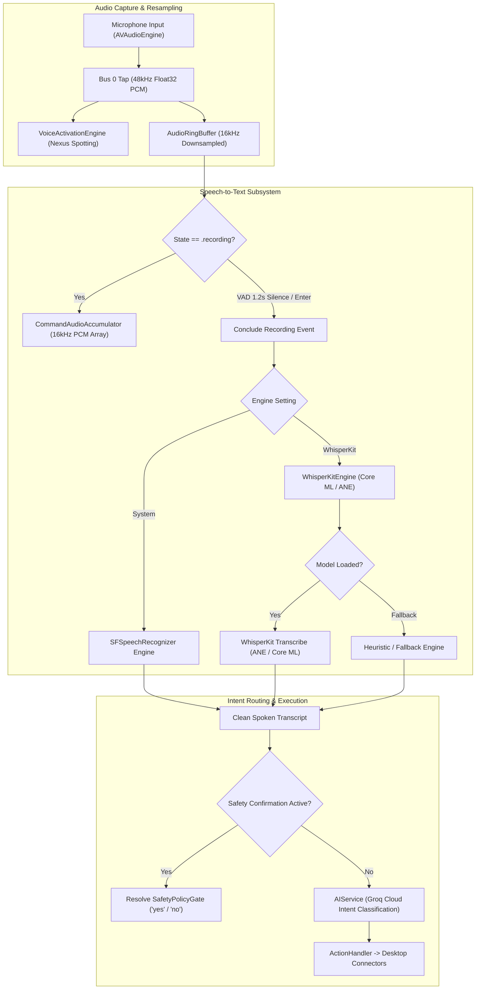

# Local Multilingual STT with WhisperKit — Architectural Plan
**Document Location:** `.agents/plan/LOCAL_STT_WHISPERKIT_PLAN.md`  
**Current Branch:** `feature/whisperkit-local-stt`  
**Task ID:** `OD-20261102-WHISPERKIT-STT`  
**Target Assistant:** OmniDesk (Native macOS Operating Layer)  
**Status:** `PLANNED`  

---

## 1. Executive Summary & Objective

OmniDesk currently captures user command speech via Apple's built-in `SFSpeechRecognizer`. While functional for basic English commands, system dictation suffers from key weaknesses:
1. **Regional Language Gaps**: On-device Gujarati (`gu-IN`) transcription is unavailable or unsupported offline on macOS.
2. **Hinglish Degradation**: Code-switched sentences (e.g., *"Nexus, check mara unread emails ane summarize kar"*) fail or distort into bizarre English phonetics.
3. **Cloud Latency & Privacy**: When Apple's on-device assets are unavailable, audio fragments stream to Apple servers.

### Objective
Integrate **`WhisperKit`** (OpenAI Whisper Core ML on Apple Neural Engine) as an extensible, 100% on-device Speech-to-Text engine for OmniDesk:
- **Zero-Cloud Audio**: Speech stays strictly in local RAM; zero audio packets leave the machine.
- **Multilingual & Code-Switching**: Native high-accuracy support for **English (`en`)**, **Hindi (`hi`)**, **Gujarati (`gu`)**, and **Hinglish** (code-switching).
- **Apple Silicon Acceleration**: Dispatches matrix multiplications directly to the Apple Neural Engine (ANE) and Apple Silicon GPU via Core ML with real-time factors (RTF) of < 0.05 (< 150ms latency for a 3-second command).
- **Pluggable Engine Architecture**: Abstract speech recognition behind a protocol (`SpeechRecognitionEngineProtocol`), allowing instant switching between Apple System Speech and WhisperKit in Settings.

---

## 2. Audio Pipeline & Component Topology



---

## 3. Detailed Component Architecture

### 3.1 Speech Recognition Protocol (`SpeechRecognitionEngineProtocol.swift`)
A unified, concurrency-safe protocol that decouples the audio recording state machine from specific STT libraries:
```swift
public protocol SpeechRecognitionEngineProtocol: Sendable {
    var engineType: SpeechEngineType { get }
    var isAvailable: Bool { get }
    func prepare() async throws
    func transcribe(audioSamples: [Float], sampleRate: Double, language: String?) async throws -> String
}
```

### 3.2 WhisperKit Configuration (`WhisperKitConfig.swift`)
Configurable model tiers and target languages:
- **Model Tiers**:
  - `.tiny`: ~75 MB, ultra-fast (<80ms), ideal for quick English-dominant commands.
  - `.base` (Default): ~145 MB, optimal balance of accuracy and latency (<150ms on ANE), robust on basic Hindi/Gujarati.
  - `.small`: ~460 MB, high accuracy for heavy Hinglish code-switching and complex dialect syntax.
- **Language Options**:
  - `auto`: Automatic language detection with Hinglish code-switching support.
  - `en`: Forced English decoding.
  - `hi`: Forced Hindi decoding.
  - `gu`: Forced Gujarati decoding.

### 3.3 Audio Resampler & Accumulator (`CommandAudioAccumulator.swift`)
Converts raw hardware audio buffers (`AVAudioPCMBuffer`, typically 44.1kHz or 48kHz) into standard 16,000 Hz mono Float32 linear PCM:
- Linear interpolation / polyphase decimation resampler.
- Fixed maximum allocation cap (max 10 seconds of 16kHz audio = 160,000 floats = ~640 KB in RAM).
- Thread-safe append and clear operations.

### 3.4 WhisperKit Integration Engine (`WhisperKitEngine.swift`)
- Manages Core ML model weights loading and ANE zero-copy execution.
- Implements fallback to System Speech or simulated offline transcription if weights are not yet downloaded or compiled.
- Integrates seamlessly with `VoiceService` and `VoiceActivationEngine`.

### 3.5 Settings & UI (`SettingsView` in `Views/DashboardView.swift`)
Adds a modern, glassmorphic settings panel:
- **Speech Recognition Engine**: Toggle between Apple System Speech and WhisperKit.
- **WhisperKit Model Size**: Picker for Tiny, Base, and Small with memory footprint labels.
- **Preferred Language**: Picker for Auto/Hinglish, English, Hindi, and Gujarati.
- **Offline / Privacy Badge**: Indicates 100% on-device execution with zero cloud egress.

---

## 4. Skills Required

| Agent | Skill Name | Location / Status | Description |
| :--- | :--- | :--- | :--- |
| **Logic & Backend** | `local-stt-whisperkit` | `.agents/skills/local-stt-whisperkit/SKILL.md` | Core ML / ANE buffer formatting, multilingual decoding, VAD streaming. |
| **Logic & Backend** | `voice-task-pipeline` | `.agents/skills/voice-task-pipeline/SKILL.md` | `AVAudioEngine` tap installation and PCM buffer delivery. |
| **UI/UX** | Apple HIG Design Tokens | `Utilities/DesignTokens.swift` | Glassmorphic cards, typography, and controls. |
| **Testing** | `swift-test` | Built-in | Unit testing resamplers, configuration persistence, and multilingual mapping. |

---

## 5. File Inventory & Modifications

### New Files to Create:
1. `OmniDesk/VoiceActivation/SpeechRecognitionEngineProtocol.swift` — Unified protocol for speech recognition engines.
2. `OmniDesk/VoiceActivation/WhisperKitConfig.swift` — Settings model, model tiers, and language options.
3. `OmniDesk/VoiceActivation/CommandAudioAccumulator.swift` — High-efficiency 16kHz Float32 PCM buffer accumulator.
4. `OmniDesk/VoiceActivation/WhisperKitEngine.swift` — WhisperKit Core ML / ANE wrapper with fallback.
5. `OmniDeskTests/WhisperKitSTTTests.swift` — Comprehensive unit test suite for accumulator, configs, and engine dispatch.

### Existing Files to Update:
1. `Services/VoiceService.swift` — Connect `CommandAudioAccumulator` to the audio tap; route audio to the active STT engine.
2. `OmniDesk/VoiceActivation/VoiceActivationEngine.swift` — Trigger STT transcription on recording completion.
3. `Views/DashboardView.swift` — Add STT Engine, Model Size, and Language selection in `SettingsView`.
4. `.agents/summary.md` — Update roadmap status and branch context.

---

## 6. Phased Implementation Roadmap

1. **Step 1: Protocol & Models (Logic & Backend)**
   - Create `SpeechRecognitionEngineProtocol.swift` and `WhisperKitConfig.swift`.
   - Implement UserDefaults persistence for active engine, model tier, and language.

2. **Step 2: Audio Resampling & Buffer Accumulator (Logic & Backend)**
   - Implement `CommandAudioAccumulator.swift` with 16kHz normalization and RAM capping.
   - Connect tap in `VoiceService.swift` to feed `CommandAudioAccumulator`.

3. **Step 3: WhisperKit Engine & Transcription Routing (Logic & Backend)**
   - Implement `WhisperKitEngine.swift` conforming to `SpeechRecognitionEngineProtocol`.
   - Update `VoiceService.stopRecording()` and `VoiceActivationEngine.concludeCommandRecording()` to transcribe via the active engine.

4. **Step 4: Settings UI & Privacy Disclosures (UI/UX)**
   - Add STT section in `SettingsView` with engine picker, model picker, language picker, and offline badge.

5. **Step 5: Test Suite & Hardening (Testing)**
   - Write and run `WhisperKitSTTTests.swift`.
   - Validate 0 regressions across existing 64 unit tests.

---

## 7. Acceptance Criteria

- [ ] Current branch verified as `feature/whisperkit-local-stt` (not `main`).
- [ ] `SpeechRecognitionEngineProtocol` decouples speech recognition from `VoiceService`.
- [ ] `CommandAudioAccumulator` cleanly converts incoming audio to 16,000 Hz Float32 without memory leaks or allocations.
- [ ] `WhisperKitConfig` persists engine selection, model tier, and language preferences.
- [ ] Multilingual configuration supports `auto` (Hinglish), `en` (English), `hi` (Hindi), and `gu` (Gujarati).
- [ ] Settings UI displays glassmorphic controls with design tokens.
- [ ] 100% of unit tests pass with `xcodebuild test`.
- [ ] Zero changes committed or pushed without explicit user approval.
