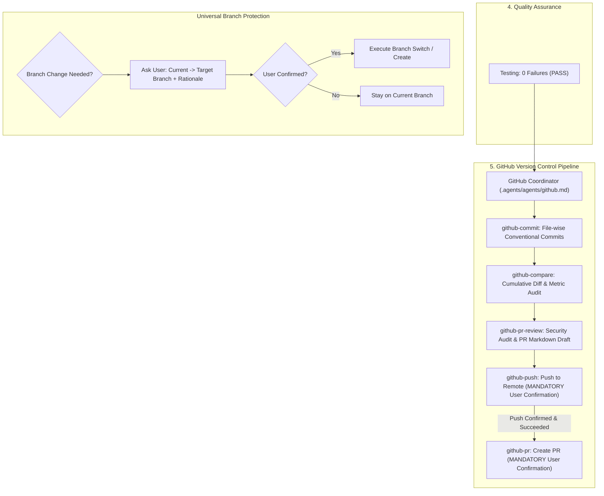

# OmniDesk: GitHub PR Subagent & Mandatory Branch Change Guardrail Plan
**Document Location:** `.agents/plan/PR_AGENT_AND_BRANCH_GUARD_PLAN.md`  
**Status:** Architectural Specification & Implementation Plan (Phase 1 — Plan Mode)  
**Task ID:** `OD-20261101-PR-AGENT-AND-BRANCH-GUARD`  
**Author:** Orchestrator & Senior Agent-Systems Architect  
**Created Date:** 2026-11-01  

---

## 1. Goal Description

This task enhances OmniDesk's multi-agent development workflow in two critical areas:
1. **GitHub PR Subagent (`github-pr`)**: Introduce a specialized subagent at [`.agents/agents/github-pr.md`](../agents/github-pr.md) that handles conflict checking and Pull Request creation following confirmed remote pushes, completing the version control lifecycle.
2. **Mandatory Branch Change Guardrail**: Update [`AGENTS.md`](../../AGENTS.md) and all relevant agent definitions ([`orchestrator.md`](../agents/orchestrator.md), [`planner.md`](../agents/planner.md), [`github.md`](../agents/github.md), and subagents) to strictly enforce that **no agent may switch, checkout, or create a git branch without first asking for and receiving explicit user confirmation**.

---

## 2. User Review Required

> [!IMPORTANT]
> **Mandatory Branch Change Confirmation**:
> Agents will no longer be permitted to run `git checkout <branch>`, `git switch <branch>`, or `git checkout -b <branch>` autonomously. Whenever a branch switch or new branch creation is proposed, the agent must ask the user via `ask_question` or clear prompt detailing:
> 1. Current branch
> 2. Target / New branch name
> 3. Rationale / Purpose

> [!NOTE]
> **GitHub PR Subagent Strategy**:
> `github-pr` will check for `gh` CLI authentication:
> - If `gh` is authenticated: Executes `gh pr create --base <base> --head <head> --title <title> --body <body>` after user confirmation.
> - If `gh` is not authenticated or in web mode: Verifies zero merge conflicts via `git merge-tree` and outputs a 1-click comparison/PR URL (`https://github.com/<owner>/<repo>/compare/<base>...<head>?expand=1`) with the audited PR title and markdown body pre-formatted for instant submission.

---

## 3. Architecture & Workflow



---

## 4. Proposed Changes

### Component 1: GitHub PR Subagent Specification

#### [NEW] [`.agents/agents/github-pr.md`](../agents/github-pr.md)
Create new subagent specification (strictly under 100 lines) with:
- **Purpose**: Automates pre-flight merge conflict checks and creates/opens Pull Requests on GitHub after branch push confirmation.
- **Trigger Conditions**: Invoked by GitHub Coordinator after `github-push` succeeds, or when user explicitly requests PR creation.
- **Inputs**: Current branch, target base branch (`omni`, `main`), title and description from `github-pr-review`.
- **Outputs**: Created PR URL or 1-click GitHub web PR creation link with pre-filled metadata; updated handoff contract with `status: COMPLETED`.
- **Allowed Tools**: `run_command` (`git branch`, `gh pr create`, `gh pr view`, `git merge-tree`), `read_file`, `ask_question`.
- **Forbidden Actions**:
  - Never create a PR without explicit user confirmation.
  - Never create a PR with unresolved merge conflicts.
  - Never switch or create branches autonomously.
  - Never merge or close PRs automatically.

---

### Component 2: System Guidelines & Roster Update

#### [MODIFY] [`AGENTS.md`](../../AGENTS.md)
- **Section 4 (Team Roster)**: Add `GitHub PR` (`.agents/agents/github-pr.md`) with role description.
- **Section 5 (Standard Development Workflow)**: Update the five-phase pipeline diagram to include `PR (confirmed)` after `Push (confirmed)`.
- **Section 6 (Zero-Trust & GitHub Safety Rules)**:
  - Add **Mandatory Branch Change Confirmation**:
    > "Agents must NEVER switch branches (`git checkout`, `git switch`), create a new branch (`git checkout -b`, `git switch -c`), or change the current working branch without asking for and receiving explicit user confirmation first. The confirmation prompt must specify the current branch, proposed target branch, and rationale."
  - Add **Pull Request Creation Guardrail**:
    > "The agent must verify zero merge conflicts against the target base branch and receive explicit user confirmation before creating a Pull Request."

---

### Component 3: Agent Definitions Update (Branch Guardrail)

#### [MODIFY] [`.agents/agents/orchestrator.md`](../agents/orchestrator.md)
- Under **Forbidden Actions**:
  - Add: `- **Never** switch or create git branches without explicit user confirmation.`
- Under **Behavior Guidelines**:
  - Add rule that task dispatch must ask the user before switching to or creating a feature branch.

#### [MODIFY] [`.agents/agents/planner.md`](../agents/planner.md)
- Under **Behavior Guidelines**:
  - Add rule that the plan may recommend a feature branch name, but must state that branch creation requires explicit user confirmation before execution.

#### [MODIFY] [`.agents/agents/github.md`](../agents/github.md)
- Update subagent dispatch sequence to:
  `github-commit` ➔ `github-compare` ➔ `github-pr-review` ➔ `github-push` ➔ `github-pr`.
- Update handoff contract and status to `PR_CREATED`.
- Under **Forbidden Actions**:
  - Add: `- **Never** switch or create branches without explicit user confirmation.`

#### [MODIFY] [`.agents/agents/github-commit.md`](../agents/github-commit.md)
- Under **Forbidden Actions**:
  - Add: `- **Never** switch branches or create new branches (must commit strictly on the active branch).`

#### [MODIFY] [`.agents/agents/github-push.md`](../agents/github-push.md)
- Under **Handoff Contract**:
  - Update `next_agent: "github-pr"` (handoff to PR creator once push succeeds).
- Under **Forbidden Actions**:
  - Add: `- **Never** switch or create branches.`

#### [MODIFY] [`.agents/agents/github-compare.md`](../agents/github-compare.md) & [`.agents/agents/github-pr-review.md`](../agents/github-pr-review.md)
- Add branch change restriction to Forbidden Actions.

---

### Component 4: Documentation Synchronization

#### [MODIFY] [`.agents/plan/AGENT_SYSTEM_PLAN.md`](AGENT_SYSTEM_PLAN.md)
- Update multi-agent roster and workflow diagram to include `github-pr` and the branch change safety guardrail.

---

## 5. Verification Plan

### Automated Checks
1. Verify line count of all files in `.agents/agents/`:
   ```bash
   wc -l .agents/agents/*.md
   ```
   *Expectation*: Every agent specification file must be strictly under 100 lines.
2. Verify git status and check for forbidden syntax or malformed markdown:
   ```bash
   git status -s
   ```
3. Run existing unit test suite to ensure zero impact on Swift application targets:
   ```bash
   xcodebuild test -project OmniDesk.xcodeproj -scheme OmniDesk -destination 'platform=macOS' -only-testing:OmniDeskTests
   ```
   *Expectation*: 46 / 46 passing tests.

### Manual Verification
1. Verify `AGENTS.md` clearly lists the branch change confirmation rule and the new `GitHub PR` subagent.
2. Verify the sequential workflow (`github-commit` ➔ `github-compare` ➔ `github-pr-review` ➔ `github-push` ➔ `github-pr`) has consistent handoff contracts across all agents.
3. Test prompting behavior when branch change is requested.
