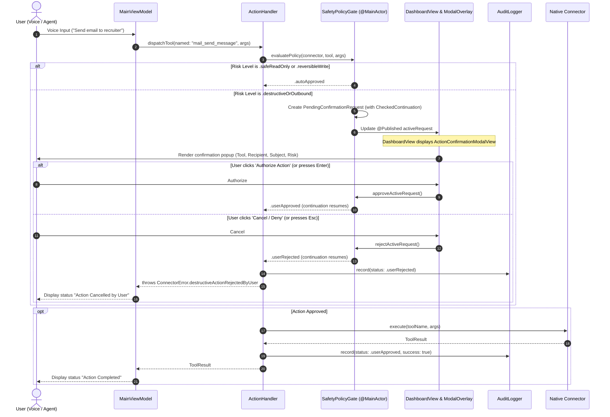

# Architectural Plan: Wiring ActionConfirmationModalView into DashboardView

**Author**: Senior macOS Systems Architect  
**Date**: October 30, 2026  
**Status**: Proposed / Pending User Review  
**Target File**: [`Views/DashboardView.swift`](file:///Users/dhruvilpatel/Desktop/OmniDesk/Views/DashboardView.swift)  
**Associated Subsystems**: [`Views/ActionConfirmationModalView.swift`](file:///Users/dhruvilpatel/Desktop/OmniDesk/Views/ActionConfirmationModalView.swift), [`Services/Safety/SafetyPolicyGate.swift`](file:///Users/dhruvilpatel/Desktop/OmniDesk/Services/Safety/SafetyPolicyGate.swift), [`ActionRouters/ActionHandler.swift`](file:///Users/dhruvilpatel/Desktop/OmniDesk/ActionRouters/ActionHandler.swift), [`Services/Safety/AuditLogger.swift`](file:///Users/dhruvilpatel/Desktop/OmniDesk/Services/Safety/AuditLogger.swift)

---

## 1. Executive Summary & Architecture

OmniDesk features a local-first Zero-Trust safety architecture where all tool invocations are evaluated against their risk classification (`.safeReadOnly`, `.reversibleWrite`, `.destructiveOrOutbound`). While the underlying continuation-based engine (`SafetyPolicyGate`) and modal dialog view (`ActionConfirmationModalView`) are fully tested and functional in isolation, `ActionConfirmationModalView` is not yet embedded into the root window hierarchy of [`DashboardView.swift`](file:///Users/dhruvilpatel/Desktop/OmniDesk/Views/DashboardView.swift), and tool dispatching through [`ActionHandler.swift`](file:///Users/dhruvilpatel/Desktop/OmniDesk/ActionRouters/ActionHandler.swift) does not yet systematically evaluate `SafetyPolicyGate` during live user-facing execution.

### Architectural Objectives
1. **Root Window Overlay**: Mount `ActionConfirmationModalView` directly in `DashboardView` via a reactive `.overlay` with smooth spring transitions and dimmed backdrop dismissal protection.
2. **Universal Policy Gating in `ActionHandler`**: Wire `SafetyPolicyGate.shared.evaluatePolicy(...)` into `ActionHandler.dispatchTool(named:arguments:)` and `ActionHandler.executeTool(...)` so that any destructive or outbound action (whether triggered by Voice, AI Agent, or internal dispatch) pauses execution and requests human authorization.
3. **Design System Consistency**: Elevate `ActionConfirmationModalView` styling using OmniDesk's adaptive semantic tokens (`Color.omniCardSurface`, `Color.omniBorder`, `Color.omniTextPrimary`, `Color.omniTextSecondary`, `Color.omniAmber`, `Color.omniRed`) to match Light, Dark, and System appearance modes.
4. **Interactive Keyboard Ergonomics**: Support standard macOS confirmation shortcuts (`Escape` to Cancel/Deny, `Return` / `Enter` to Authorize).



---

## 2. UI Layer Wiring in `DashboardView.swift`

### Current State
[`DashboardView.swift`](file:///Users/dhruvilpatel/Desktop/OmniDesk/Views/DashboardView.swift) currently defines the root container with a fixed frame constraint (`540x620` to `660x720`), top navigation bar, status pill, settings popover, voice capture area, task list, and footer. It does not observe `SafetyPolicyGate.shared`.

### Proposed Presentation Strategy
We will mount `ActionConfirmationModalView` at the root level using an `.overlay` modifier on `DashboardView`:

```swift
struct DashboardView: View {
    @StateObject private var voiceService = VoiceService()
    @StateObject private var viewModel = MainViewModel()
    @ObservedObject private var themeManager = ThemeManager.shared
    @ObservedObject private var policyGate = SafetyPolicyGate.shared // <-- Observe Policy Gate
    @State private var showSettingsSheet: Bool = false
    
    var body: some View {
        VStack(spacing: 0) {
            // Existing top bar, main content, and footer...
        }
        .frame(minWidth: 540, maxWidth: 660, minHeight: 620, maxHeight: 720)
        .background(Color.omniBackground.ignoresSafeArea())
        .preferredColorScheme(themeManager.currentTheme.colorScheme)
        .overlay {
            // Modal Confirmation Sheet Overlay
            if policyGate.activeRequest != nil {
                ActionConfirmationModalView(policyGate: policyGate)
                    .transition(
                        .asymmetric(
                            insertion: .opacity.combined(with: .scale(scale: 0.96)),
                            removal: .opacity.combined(with: .scale(scale: 0.98))
                        )
                    )
            }
        }
        .animation(.spring(response: 0.28, dampingFraction: 0.82), value: policyGate.activeRequest != nil)
    }
}
```

### Why `.overlay` over `.sheet` or `.fullScreenCover` on macOS?
1. **Lightweight & Window-Scoped**: Native macOS `.sheet` introduces a separate system window hierarchy and titlebar animation that disrupts the minimalist, borderless Jarvis aesthetic.
2. **Immediate Responsiveness**: An in-window `.overlay` with `.transition` responds in `<16ms`, providing zero frame-drop feedback when a background tool hits the safety gate.
3. **Focus & Keyboard Navigation**: The modal retains keyboard event responders within the active key window without requiring sheet window delegate management.

---

## 3. Design Polish of `ActionConfirmationModalView.swift`

We will update [`ActionConfirmationModalView.swift`](file:///Users/dhruvilpatel/Desktop/OmniDesk/Views/ActionConfirmationModalView.swift) to utilize OmniDesk's unified adaptive design tokens:

### Key Design Enhancements:
- **Backdrop Dimming**: `Color.black.opacity(0.45)` with interactive hit-testing capture to prevent clicking underlying controls.
- **Modal Surface**: Styled with `Color.omniCardSurface`, crisp `1px` border using `Color.omniBorder`, and subtle drop shadow (`radius: 20, y: 10`).
- **Risk Badge**: Dynamic risk level tag with hierarchical SF Symbols:
  - `.destructiveOrOutbound`: `Color.omniRed.opacity(0.15)` background with `Color.omniRed` text and `exclamationmark.shield.fill`.
  - `.reversibleWrite`: `Color.omniAmber.opacity(0.15)` background with `Color.omniAmber` text.
- **Parameter Inspection Table**: Clean monospaced key-value grid with alternating row highlights, wrapped inside a recessed card (`Color.omniInputSurface`).
- **Standardized Keyboard Shortcuts**:
  - Cancel button: `.keyboardShortcut(.cancelAction)` (triggered by `Escape`).
  - Authorize button: `.keyboardShortcut(.defaultAction)` (triggered by `Return` / `Enter`).

---

## 4. Universal Gating in `ActionHandler.swift`

Currently, `ActionHandler.dispatchTool` directly invokes `connector.execute`. We will upgrade `ActionHandler` to evaluate policy before dispatching:

```swift
public func dispatchTool(named toolName: String, arguments: [String: Any]) async throws -> ToolResult {
    let active = allConnectors
    guard let connector = active.first(where: { $0.tools.contains(where: { $0.name == toolName }) }),
          let toolDef = connector.tools.first(where: { $0.name == toolName }) else {
        throw ConnectorError.targetNotFound(identifier: "No connector provides tool '\(toolName)'")
    }
    
    let startTime = CFAbsoluteTimeGetCurrent()
    
    // Safety Policy Gate Evaluation
    let approval = await SafetyPolicyGate.shared.evaluatePolicy(
        connector: connector,
        tool: toolDef,
        arguments: arguments
    )
    
    guard approval == .autoApproved || approval == .userApproved else {
        let duration = (CFAbsoluteTimeGetCurrent() - startTime) * 1000
        AuditLogger.shared.record(
            connectorId: connector.id,
            toolName: toolName,
            arguments: arguments,
            riskLevel: toolDef.riskLevel,
            approvalStatus: .userRejected,
            durationMs: duration,
            success: false,
            errorMessage: "Action rejected by user."
        )
        throw ConnectorError.destructiveActionRejectedByUser
    }
    
    // Execute Tool & Record Audit Log
    do {
        let result = try await connector.execute(toolName: toolName, arguments: arguments)
        let duration = (CFAbsoluteTimeGetCurrent() - startTime) * 1000
        AuditLogger.shared.record(
            connectorId: connector.id,
            toolName: toolName,
            arguments: arguments,
            riskLevel: toolDef.riskLevel,
            approvalStatus: approval,
            durationMs: duration,
            success: result.success,
            errorMessage: result.error
        )
        return result
    } catch {
        let duration = (CFAbsoluteTimeGetCurrent() - startTime) * 1000
        AuditLogger.shared.record(
            connectorId: connector.id,
            toolName: toolName,
            arguments: arguments,
            riskLevel: toolDef.riskLevel,
            approvalStatus: approval,
            durationMs: duration,
            success: false,
            errorMessage: error.localizedDescription
        )
        throw error
    }
}
```

---

## 5. Skills Required & Knowledge Catalog

| Skill Name | Relevance & Context | Location |
| :--- | :--- | :--- |
| **`macos-security-tcc`** | Documents TCC permissions and safety isolation rules when prompting user for external Apple Events (`mail_send_message`) or Accessibility (`apps_perform_ui_action`). | [`.agents/skills/macos-security-tcc/SKILL.md`](file:///Users/dhruvilpatel/Desktop/OmniDesk/.agents/skills/macos-security-tcc/SKILL.md) |
| **`swift-mcp-engine`** | Covers JSON-RPC 2.0 error reporting when an action is rejected by human policy gate (`code: -32001`). | [`.agents/skills/swift-mcp-engine/SKILL.md`](file:///Users/dhruvilpatel/Desktop/OmniDesk/.agents/skills/swift-mcp-engine/SKILL.md) |
| **`voice-task-pipeline`** | Connects voice input intent classification to the tool dispatch pipeline in `MainViewModel`. | [`.agents/skills/voice-task-pipeline/SKILL.md`](file:///Users/dhruvilpatel/Desktop/OmniDesk/.agents/skills/voice-task-pipeline/SKILL.md) |

---

## 6. Verification Plan

### Automated Tests
Add test cases in [`OmniDeskTests/OmniDeskTests.swift`](file:///Users/dhruvilpatel/Desktop/OmniDesk/OmniDeskTests/OmniDeskTests.swift):
1. **`testActionHandlerSafetyGateInterception`**:
   - Call `ActionHandler.shared.dispatchTool(named: "mail_send_message", arguments: [...])` asynchronously.
   - Verify `SafetyPolicyGate.shared.activeRequest != nil`.
   - Verify request has `toolName == "mail_send_message"`, risk `.destructiveOrOutbound`.
   - Call `SafetyPolicyGate.shared.rejectActiveRequest()`.
   - Verify `ConnectorError.destructiveActionRejectedByUser` is thrown.
   - Verify `AuditLogger` recorded `approvalStatus == .userRejected`.
2. **`testActionHandlerSafetyGateApproval`**:
   - Dispatch `mail_create_draft` (reversible) with `autoApproveReversibleActions = false`.
   - Call `SafetyPolicyGate.shared.approveActiveRequest()`.
   - Verify tool executes successfully and `AuditLogger` records `approvalStatus == .userApproved`.

Execute test suite:
```bash
xcodebuild test -project OmniDesk.xcodeproj -scheme OmniDesk -destination 'platform=macOS' -only-testing:OmniDeskTests
```

### Manual Verification
1. Run the app target in macOS.
2. Issue a voice command or trigger an outbound tool (e.g., "Send email to test@example.com").
3. Verify that the dimmed overlay and `ActionConfirmationModalView` appear centered on screen with clear parameters.
4. Press `Escape` (or click "Cancel / Deny") — verify modal dismisses and status bar indicates "Action Cancelled".
5. Trigger again and press `Return` (or click "Authorize Action") — verify action executes and status bar indicates success.

---

## 7. Sources & References

- [Apple Developer: macOS Human Interface Guidelines - Modals](https://developer.apple.com/design/human-interface-guidelines/modals)
- [Swift Concurrency: CheckedContinuation SE-0300](https://github.com/swiftlang/swift-evolution/blob/main/proposals/0300-continuation.md)
- [Apple Developer: View.overlay(_:alignment:)](https://developer.apple.com/documentation/swiftui/view/overlay(_:alignment:))
- [OmniDesk Architecture Plan](file:///Users/dhruvilpatel/Desktop/OmniDesk/.agents/plan/CONNECTOR_PLAN.md)
