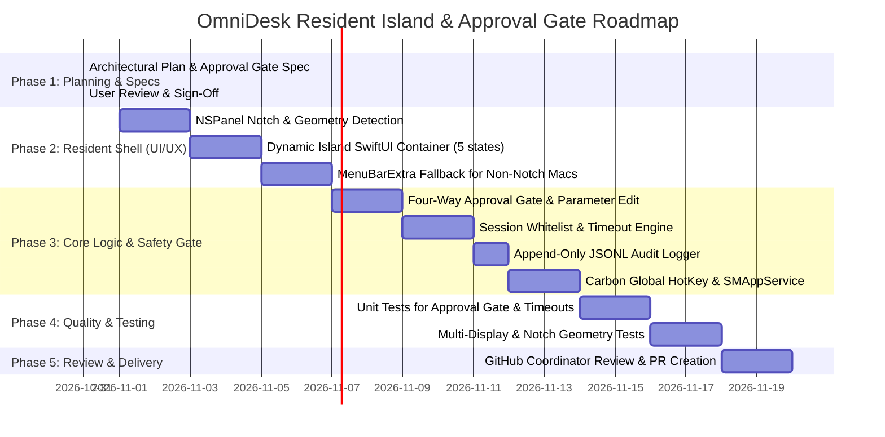

# OmniDesk: Dynamic Island Notch & Menu-Bar Resident Assistant Architecture
**Document Location:** `.agents/plan/dynamic_plans.md`  
**Status:** Architectural Specification & Implementation Plan (Phase 1 — Plan Mode)  
**Author:** Orchestrator & Senior macOS Systems Architect  
**Target Assistant:** OmniDesk (Native macOS "Jarvis-Style" Operating Layer)  
**Created Date:** 2026-10-31  

---

## 1. Goal, Scope, and Non-Goals

### 1.1 Goal
Transform OmniDesk from a conventional standalone desktop window application into an **always-available, ambient, notch- and menu-bar-resident macOS assistant**. OmniDesk will live seamlessly in the user's hardware display notch (as an expandable "Dynamic Island" panel) or in the macOS menu bar as a status item, providing instant voice/chat access via a global hotkey, while strictly enforcing a **pre-execution approval gate** for all mutating, outbound, or high-risk actions.

### 1.2 Scope
- **Notch Resident UI ("Dynamic Island")**: Hardware-anchored floating `NSPanel` centered over the MacBook camera notch. Collapsed: status pill with live visual indicators (listening waveform, task activity, risk badge). Expanded: full chat input, active task status, and structured approval dialogs.
- **Menu Bar Fallback**: For external monitors or Macs without a camera notch (Mac mini, Mac Studio, Mac Pro, older MacBooks), OmniDesk renders as a native menu bar accessory (`NSStatusItem` / `MenuBarExtra`) with identical functionality.
- **Accessory App Lifecycle**: Configured as an accessory process (`LSUIElement = YES` in `Info.plist`), with no persistent Dock icon, automatic login launch via `SMAppService`, and instant toggling via a global hotkey (`⌥ Space` or user-configured).
- **Pre-Execution Approval Gate**: Interception of every tool action prior to execution. Displays plain-English explanation, target connector, tool name, and exact parameters. Provides four controls: **Approve**, **Deny**, **Edit Parameters**, and **Allow for this Session**.
- **Timeout & Edge-Case Protection**: Timed countdown defaulting to **Deny**. Complete serialization of concurrent requests. Clean continuation cancellation if the app terminates mid-approval.
- **Audit Logging**: Comprehensive, append-only JSON Lines audit trail recording proposals, approvals, denials, parameter edits, timeouts, and execution outcomes.
- **macOS TCC Handshake**: Architectural separation between application-level safety gating and macOS system TCC prompts, with guided recovery flows upon TCC denial.
- **Standalone Window Demotion**: The existing `DashboardView` window is decoupled and becomes an optional auxiliary window for history logs, settings, and task archive management.

### 1.3 Non-Goals
- Full window tiling manager integration (OmniDesk floats above all windows and Spaces; it does not manage third-party window layouts).
- Cloud-based synchronization of audit logs (all audit records remain strictly local to `~/Library/Logs/OmniDesk/`).
- Bypassing or disabling macOS Transparency, Consent, and Control (TCC) system dialogues.
- Silent "always allow" bypasses for destructive or outbound network actions (`mail_send_message`, `apps_terminate`, shell commands).

---

## 2. System Architecture & Topology

```mermaid
flowchart TD
    subgraph Hardware_Display_Layer ["Hardware & Display Detection Layer"]
        ScreenDetector["Screen & Notch Geometry Detector (NSScreen)"]
        HotKeyEngine["Carbon Global HotKey Manager (RegisterEventHotKey)"]
        LoginService["Login Item Service (SMAppService.mainApp)"]
    end

    subgraph Presentation_Layer ["Resident Presentation Layer (SwiftUI + AppKit)"]
        PanelController["DynamicIslandPanelController (NSPanel: .popUpMenu)"]
        MenuBarController["MenuBarExtraController (NSStatusItem Fallback)"]
        IslandView["DynamicIslandContainerView (SwiftUI)"]
        
        PanelController --> IslandView
        MenuBarController --> IslandView
        ScreenDetector -->|Has Notch| PanelController
        ScreenDetector -->|No Notch / External| MenuBarController
    end

    subgraph State_Machine ["Resident UI State Machine"]
        CollapsedPill["1. Collapsed Pill (Idle / Ambient RMS)"]
        ExpandedIsland["2. Expanded Island (Voice / Text Input)"]
        ApprovalPrompt["3. Approval Gate Prompt (Approve / Deny / Edit)"]
        RunningFeedback["4. Running Execution Status"]
        ErrorResolution["5. Error & TCC Resolution Banner"]
        
        CollapsedPill <-->|Hotkey / Click / Hover| ExpandedIsland
        ExpandedIsland -->|Intent Triggers Action| ApprovalPrompt
        ApprovalPrompt -->|Approved| RunningFeedback
        ApprovalPrompt -->|Denied / Timeout| CollapsedPill
        RunningFeedback -->|Success| CollapsedPill
        RunningFeedback -->|Failure / TCC Denied| ErrorResolution
    end

    subgraph Safety_Gate_Engine ["Zero-Trust Safety & Governance Engine"]
        Gate["SafetyPolicyGate (@MainActor)"]
        Queue["ActionQueueManager (Serialized Pending Requests)"]
        Timer["ApprovalTimeoutTimer (Default: 60s -> Auto Deny)"]
        SessionWhitelist["SessionApprovalStore (Ephemeral In-Memory Whitelist)"]
        Audit["AuditLogger (~/Library/Logs/OmniDesk/audit.jsonl)"]
        
        Gate --> Queue
        Queue --> Timer
        Queue --> SessionWhitelist
        Gate --> Audit
    end

    subgraph Execution_Layer ["Connector & Platform Bus"]
        ActionHandler["ActionHandler (Tool Dispatcher)"]
        CalendarConn["CalendarConnector (EventKit)"]
        MailConn["MailConnector (AppleScript)"]
        ObsidianConn["ObsidianConnector (Security-Scoped Bookmarks)"]
        AppConn["AppControlConnector (NSRunningApp / POSIX)"]
        MCPBridge["MCPServerEngine (JSON-RPC 2.0 stdio)"]
        
        ActionHandler --> CalendarConn
        ActionHandler --> MailConn
        ActionHandler --> ObsidianConn
        ActionHandler --> AppConn
        ActionHandler --> MCPBridge
    end

    ApprovalPrompt -->|Resume Continuation| Gate
    Gate -->|Authorized Action Payload| ActionHandler
```



---

## 3. UI/UX Design & Display Specifications

### 3.1 Display Detection & Notch Geometry
In macOS 12 (Monterey) and later, Apple introduced hardware displays with a camera housing ("notch") on MacBook Pro (14" and 16") and MacBook Air (M2/M3).
- **Detection Algorithm**:
  ```swift
  extension NSScreen {
      var hasHardwareNotch: Bool {
          if #available(macOS 12.0, *) {
              return auxiliaryTopLeftArea != nil && auxiliaryTopRightArea != nil
          }
          return false
      }
      
      var notchRect: NSRect? {
          guard #available(macOS 12.0, *),
                let left = auxiliaryTopLeftArea,
                let right = auxiliaryTopRightArea else { return nil }
          let notchWidth = frame.width - (left.width + right.width)
          let notchHeight = left.height
          let notchX = left.maxX
          let notchY = frame.maxY - notchHeight
          return NSRect(x: notchX, y: notchY, width: notchWidth, height: notchHeight)
      }
  }
  ```
- **Panel Window Attributes**:
  - Subclass: `NSPanel` conforming to `NSWindowDelegate`.
  - Style Mask: `[.borderless, .nonactivatingPanel, .fullSizeContentView]`.
  - Window Level: `NSWindow.Level.popUpMenu` (level 101) or `CGWindowLevelKey.statusWindow` (level 25). This guarantees the island floats above the menu bar, standard windows, and full-screen apps without stealing keyboard focus unexpectedly.
  - Collection Behavior: `[.canJoinAllSpaces, .fullScreenAuxiliary, .stationary, .ignoresCycle]`. This allows the Dynamic Island to persist over full-screen Spaces (e.g. Xcode or Keynote in full-screen) without forcing macOS to switch Spaces.
  - Background: `isOpaque = false`, `backgroundColor = .clear`, `hasShadow = false` (shadow is rendered natively in SwiftUI using glassmorphic blur filters).

### 3.2 Resident UI States

```
┌────────────────────────────────────────────────────────────────────────┐
│ STATE 1: COLLAPSED PILL (Anchored to Notch / Menu Bar)                 │
│                                                                        │
│                ┌─────── [ • ] Groq Ready ───────┐                      │
│                └────────────────────────────────┘                      │
└────────────────────────────────────────────────────────────────────────┘

┌────────────────────────────────────────────────────────────────────────┐
│ STATE 2: EXPANDED ISLAND (Active Voice / Text Input)                   │
│                                                                        │
│   ┌────────────────────────────────────────────────────────────────┐   │
│   │  🎙️ Listening... [  ▂ ▃ ▅ ▆ ▇ ▅ ▃   ]          ESC to Close   │   │
│   │  "Send an email to John about the internship interview tomorrow"│   │
│   │                                                                │   │
│   │  [ Active Model: Llama-3.1-8B-Instant ]       [ ⚙️ Settings ]  │   │
│   └────────────────────────────────────────────────────────────────┘   │
└────────────────────────────────────────────────────────────────────────┘

┌────────────────────────────────────────────────────────────────────────┐
│ STATE 3: APPROVAL PROMPT (Pre-Execution Permission Gate)               │
│                                                                        │
│   ┌────────────────────────────────────────────────────────────────┐   │
│   │  🛡️ ACTION APPROVAL REQUIRED               [ DESTRICTIVE ]    │   │
│   │  OmniDesk is requesting permission to execute:                 │   │
│   │                                                                │   │
│   │  Connector: Apple Mail  |  Tool: mail_send_message             │   │
│   │  Recipient: john.doe@example.com                               │   │
│   │  Subject:   Internship Interview Confirmation                  │   │
│   │  Body:      Hi John, I confirm tomorrow at 2 PM PST...         │   │
│   │                                                                │   │
│   │  ⏱️ Auto-denying in 48s...                                     │   │
│   │                                                                │   │
│   │  [ Deny (⎋) ]   [ Edit (E) ]   [ Allow for Session ]   [ Approve (⏎) ]│
│   │  Badge: Say "Approve", "Deny", or "Edit" to respond hands-free │   │
│   └────────────────────────────────────────────────────────────────┘   │
└────────────────────────────────────────────────────────────────────────┘

┌────────────────────────────────────────────────────────────────────────┐
│ STATE 4: RUNNING FEEDBACK                                              │
│                                                                        │
│   ┌────────────────────────────────────────────────────────────────┐   │
│   │  ⏳ Executing 'mail_send_message'...                           │   │
│   │  Communicating with Apple Mail via AppleScript Bridge...       │   │
│   └────────────────────────────────────────────────────────────────┘   │
└────────────────────────────────────────────────────────────────────────┘

┌────────────────────────────────────────────────────────────────────────┐
│ STATE 5: ERROR & TCC RESOLUTION                                        │
│                                                                        │
│   ┌────────────────────────────────────────────────────────────────┐   │
│   │  ⚠️ TCC Permission Required: Automation (Apple Mail)           │   │
│   │  macOS denied Apple Event permission (-1743).                  │   │
│   │  [ Open Privacy & Security Settings ]          [ Dismiss ]     │   │
│   └────────────────────────────────────────────────────────────────┘   │
└────────────────────────────────────────────────────────────────────────┘
```

### 3.3 Notch vs. Non-Notch Behavior Matrix

| Display Scenario | Anchor Position | Primary Container | Transition Style |
| :--- | :--- | :--- | :--- |
| **MacBook with Notch (Built-in Display)** | Centered at top edge of `NSScreen.main`, snug beneath camera housing. | Custom `NSPanel` floating island. | Expands downward with spring physics (`.spring(response: 0.35, dampingFraction: 0.78)`). |
| **External Monitor / Non-Notch Display** | Upper right menu bar or screen top-center. | Menu Bar extra (`NSStatusItem`) with attached popover panel. | Drops down from status item icon. |
| **Full-Screen Space Active** | Top center of screen above full-screen window. | Same `NSPanel` enabled via `.fullScreenAuxiliary`. | Glides smoothly over full-screen content without triggering space-switch animations. |
| **Multi-Monitor Setup** | Display containing the active mouse cursor or key focus. | Dynamic repositioning on display change notifications. | Repositions or falls back to menu bar on the target display. |

---

## 4. Approval-Gate Specification

### 4.1 Risk Tiers per Connector Tool

| Tool Name | Connector | Risk Tier | Default Policy | Session Whitelist Allowed? |
| :--- | :--- | :--- | :--- | :---: |
| `calendar_list_events` | Calendar | `.safeReadOnly` | Auto-Approve (configurable) | N/A (Always Safe) |
| `calendar_find_availability` | Calendar | `.safeReadOnly` | Auto-Approve (configurable) | N/A (Always Safe) |
| `calendar_check_conflicts` | Calendar | `.safeReadOnly` | Auto-Approve (configurable) | N/A (Always Safe) |
| `calendar_create_event` | Calendar | `.reversibleWrite` | Requires Confirmation | **Yes** (Current Session) |
| `obsidian_search_notes` | Obsidian | `.safeReadOnly` | Auto-Approve (configurable) | N/A (Always Safe) |
| `obsidian_read_note` | Obsidian | `.safeReadOnly` | Auto-Approve (configurable) | N/A (Always Safe) |
| `obsidian_append_daily_note` | Obsidian | `.reversibleWrite` | Requires Confirmation | **Yes** (Current Session) |
| `mail_list_unread` | Mail | `.safeReadOnly` | Auto-Approve (configurable) | N/A (Always Safe) |
| `mail_summarize_thread` | Mail | `.safeReadOnly` | Auto-Approve (configurable) | N/A (Always Safe) |
| `mail_create_draft` | Mail | `.reversibleWrite` | Requires Confirmation | **Yes** (Current Session) |
| `mail_send_message` | Mail | `.destructiveOrOutbound` | **STRICT Confirmation Required** | **NO** (Strictly Forbidden) |
| `apps_list_running` | App Control | `.safeReadOnly` | Auto-Approve (configurable) | N/A (Always Safe) |
| `apps_launch` | App Control | `.reversibleWrite` | Requires Confirmation | **Yes** (Current Session) |
| `apps_terminate` | App Control | `.destructiveOrOutbound` | **STRICT Confirmation Required** | **NO** (Strictly Forbidden) |
| `apps_perform_ui_action` | App Control | `.systemModification` | **STRICT Confirmation Required** | **NO** (Strictly Forbidden) |
| `system_execute_shell` | System | `.systemModification` | **STRICT Confirmation Required** | **NO** (Strictly Forbidden) |

### 4.2 Data Models & Session Store

```swift
/// User decision outcome from the Approval Gate
public enum ApprovalDecision: String, Codable, Sendable {
    case approved = "approved"
    case denied = "denied"
    case editedAndApproved = "edited_and_approved"
    case sessionWhitelisted = "session_whitelisted"
    case timedOut = "timed_out"
}

/// Rich payload representing an action halted at the gate
public struct GateActionRequest: Identifiable, Sendable {
    public let id: UUID
    public let timestamp: Date
    public let connectorId: String
    public let toolName: String
    public var arguments: [String: Any]
    public let riskLevel: ActionRiskLevel
    public let plainEnglishDescription: String
    public let timeoutSeconds: TimeInterval
    public let allowsSessionWhitelist: Bool
    fileprivate let continuation: CheckedContinuation<ApprovalDecisionResult, Never>
}

public struct ApprovalDecisionResult: Sendable {
    public let decision: ApprovalDecision
    public let modifiedArguments: [String: Any]?
}
```

### 4.3 In-Memory Session Whitelist (`SessionApprovalStore`)
- Stores approved `(connectorId, toolName)` pairs valid only for the lifespan of the current application process.
- Strictly refuses to whitelist `.destructiveOrOutbound` or `.systemModification` tools.
- Automatically purged when OmniDesk quits or upon explicit user reset via Settings.

### 4.4 Audit Log Schema (`~/Library/Logs/OmniDesk/audit.jsonl`)
Every proposed action appends an immutable JSON record:
```json
{
  "id": "A1B2C3D4-E5F6-7890-ABCD-EF1234567890",
  "timestamp": "2026-10-31T20:55:00.123Z",
  "connector_id": "mail",
  "tool_name": "mail_send_message",
  "risk_level": "destructive_or_outbound",
  "payload_sha256": "e3b0c44298fc1c149afbf4c8996fb92427ae41e4649b934ca495991b7852b855",
  "parameters": {
    "recipient": "recruiter@apple.com",
    "subject": "Interview Availability"
  },
  "decision": "approved",
  "decision_duration_ms": 4200.5,
  "execution_status": "success",
  "execution_duration_ms": 312.4,
  "error": null,
  "tcc_status": "authorized"
}
```

### 4.5 Edge-Case Resolutions
1. **App Quits Mid-Approval**:
   - `NSApplicationDelegate.applicationWillTerminate` triggers `SafetyPolicyGate.shared.abortAllPendingRequests()`.
   - All continuations resume with `ApprovalDecisionResult(decision: .denied)`.
   - Audit logger writes `decision: .denied, error: "app_terminated_during_approval"`.
2. **Concurrent Request Handling**:
   - Managed via a FIFO serialized queue (`ActionQueueManager`).
   - If a multi-step task triggers 3 tools, the Dynamic Island shows *"Approval 1 of 3 (Next: Mail Compose)"*.
   - Only one continuation is held active in the UI at any instant.
3. **Voice-Triggered Actions**:
   - Hands-free voice commands are parsed.
   - When the gate opens, the Island renders the dialog and immediately starts the speech recognizer listening for confirmation triggers (`"approve"`, `"yes"`, `"confirm"` vs `"deny"`, `"cancel"`).
   - If audio input is detected matching a decision word, the dialog resolves hands-free.
4. **Timeout Handling**:
   - A 60-second visual countdown circle ticks down in the panel.
   - When the timer reaches 0, the action is automatically cancelled (`.timedOut`), the panel flashes amber, and execution halts safely.

### 4.6 macOS TCC Interaction & Denials
- **Architectural Flow**:
  1. *OmniDesk Approval Gate*: User explicitly confirms intent to send email / access calendar.
  2. *macOS TCC Evaluation*: AppKit / EventKit / AppleScript requests OS privilege.
  3. *If OS TCC Denied*:
     - Catch error codes (`errAEEventNotPermitted = -1743`, `EKErrorDomain = 1`).
     - Audit log records `tcc_status: "denied"`.
     - Panel renders actionable recovery card with a direct button opening System Settings to the exact privacy pane:
       - Apple Events: `x-apple.systempreferences:com.apple.preference.security?Privacy_Automation`
       - Calendars: `x-apple.systempreferences:com.apple.preference.security?Privacy_Calendars`
       - Reminders: `x-apple.systempreferences:com.apple.preference.security?Privacy_Reminders`

---

## 5. Migration Plan from Standalone App

| Component / File | Current State | Target Architecture | Migration Action |
| :--- | :--- | :--- | :--- |
| `OmniDesk/Info.plist` | Standard windowed app | Accessory app (`LSUIElement = true`) | Add `LSUIElement = true`. |
| `App/OmniDeskApp.swift` | `WindowGroup { DashboardView() }` | `MenuBarExtra` + `NSPanel` Controller | Remove primary `WindowGroup`; initialize `DynamicIslandPanelController` and `MenuBarExtra`. |
| `Views/DashboardView.swift` | Primary full-size desktop window | Auxiliary window for Settings & Logs | Refactor into `SettingsAndHistoryWindowView.swift`, summoned on demand. |
| `Views/ActionConfirmationModalView.swift` | Window modal overlay with darkened screen | Dynamic Island interactive approval card | Adapt view to fit inside the Dynamic Island container with parameter editing. |
| `Services/Safety/SafetyPolicyGate.swift` | Binary approve/reject gate | Four-way approval gate (Approve, Deny, Edit, Session) | Add timeout timer, parameter editing support, and session whitelist store. |
| `Services/Safety/AuditLogger.swift` | 200 in-memory items | File-persisted append-only JSONL log | Add file stream writer to `~/Library/Logs/OmniDesk/audit.jsonl`. |
| `New: Controllers/DynamicIslandPanelController.swift` | Does not exist | AppKit `NSPanel` notch manager | Create custom `NSPanel` with notch geometry tracking and floating levels. |
| `New: Views/DynamicIslandContainerView.swift` | Does not exist | SwiftUI Dynamic Island container | Implement collapsed pill, expanded island, and spring animations. |
| `New: Utilities/GlobalHotKeyManager.swift` | Does not exist | Carbon event hotkey listener | Create Carbon `RegisterEventHotKey` wrapper for `⌥ Space` without Accessibility TCC. |
| `New: Utilities/LoginItemManager.swift` | Does not exist | macOS 13+ `SMAppService` wrapper | Implement launch-at-login toggles using `SMAppService.mainApp`. |

---

## 6. Skills Required by Agent & Phase

| Development Phase | Agent | Required Skills (Existing) | Proposed Missing Skills (Name & Scope) |
| :--- | :--- | :--- | :--- |
| **Phase 1: Planning** | Planner | `.agents/skills/compact/SKILL.md`<br>`.agents/skills/macos-security-tcc/SKILL.md` | `approval-gate-ux` (Detailed UX rules for timed approvals and parameter editing). |
| **Phase 2: UI & Resident Shell** | UI/UX | `.agents/skills/voice-task-pipeline/SKILL.md`<br>`.agents/skills/macos-accessibility-automation/SKILL.md` | **`macos-notch-panel-ui`**: `NSPanel` floating notch geometry, `auxiliaryTopLeftArea`, spring expansion, multi-monitor tracking.<br>**`swiftui-menubar-extra`**: `MenuBarExtra` configuration, `LSUIElement` accessory app lifecycle, popover positioning. |
| **Phase 3: Logic & Safety Gate** | Logic & Backend | `.agents/skills/eventkit-calendar/SKILL.md`<br>`.agents/skills/macos-applescript-bridge/SKILL.md`<br>`.agents/skills/macos-security-tcc/SKILL.md`<br>`.agents/skills/security-scoped-bookmarks/SKILL.md`<br>`.agents/skills/swift-mcp-engine/SKILL.md` | **`macos-global-hotkey`**: Carbon `RegisterEventHotKey` wrapper in modern Swift without requiring Accessibility TCC permissions.<br>**`macos-login-item`**: `SMAppService.mainApp` modern login item management and status checking. |
| **Phase 4: Automated Testing** | Testing | Builtin `swift-test` | **`swift-testing`**: Parameterized testing and async continuation timeout verification for the safety gate. |
| **Phase 5: Version Control** | GitHub | `.agents/skills/compact/SKILL.md` | **`github-pr-workflow`**: Pre-flight diff auditing, secret leak prevention, and Conventional Commit structure. |

---

## 7. Phased Roadmap & Implementation Milestones



### Milestone Breakdown
- **Milestone 1: Resident Shell Prototype (UI/UX Agent)**:
  - Deliver `DynamicIslandPanelController.swift` and `MenuBarExtraController.swift`.
  - Deliver `DynamicIslandContainerView.swift` rendering collapsed pill and expanded state.
  - Verify notch alignment on built-in MacBook displays and menu bar fallback on non-notch setups.
- **Milestone 2: Enhanced Safety Gate Engine (Logic & Backend Agent)**:
  - Upgrade `SafetyPolicyGate.swift` with `ApprovalDecision` (.approved, .denied, .editedAndApproved, .sessionWhitelisted, .timedOut).
  - Implement visual countdown timer and `SessionApprovalStore`.
  - Implement file-backed `AuditLogger` writing to `~/Library/Logs/OmniDesk/audit.jsonl`.
- **Milestone 3: Hotkey & System Lifecycle (Logic & Backend Agent)**:
  - Implement `GlobalHotKeyManager` with Carbon `RegisterEventHotKey`.
  - Add `LSUIElement = true` to `Info.plist`.
  - Implement `LoginItemManager` using `SMAppService.mainApp`.
- **Milestone 4: Verification & Test Suite (Testing Agent)**:
  - Write unit tests for gate timeout, parameter editing, session caching, and concurrent request queues.
  - Run `xcodebuild test` to achieve 100% pass rate.
- **Milestone 5: Production Release (GitHub Agent)**:
  - Phase-wise atomic commits, compare diff against `main`, draft PR, and push upon user approval.

---

## 8. Test Plan & Verification Strategy

### 8.1 Automated Unit Tests (`OmniDeskTests/`)
- `testSafetyGateAutoDenyOnTimeout`: Simulate an action with a 1-second timeout. Assert that when the timer expires, the continuation resumes with `.timedOut` and does not hang.
- `testSafetyGateParameterEditing`: Verify that when user edits parameters (e.g. changing email recipient from `alice@test.com` to `bob@test.com`), the tool receives the edited parameters.
- `testSessionApprovalStoreWhitelist`: Assert that approving a `.reversibleWrite` tool with "Allow for this session" bypasses subsequent gates during the session, but attempting to whitelist a `.destructiveOrOutbound` tool throws an assertion error and requires confirmation.
- `testAuditLoggerJSONLFormat`: Assert that every logged action writes a valid JSON record to disk with correct SHA-256 digests.
- `testActionQueueFIFOOrder`: Submit 3 concurrent actions. Verify they are presented and resolved strictly in FIFO sequence.

### 8.2 UI & Integration Tests
- **Notch Alignment**: Verify that on a MacBook with a notch, the panel frame matches `NSScreen.notchRect` exactly in width and vertical alignment.
- **Spaces & Full-Screen Aux**: Verify that when entering full-screen mode in Safari or Xcode, the Dynamic Island panel remains visible and responsive without forcing a Space transition.
- **Keyboard Ergonomics**: Verify that `Return` approves, `Escape` denies, and `E` opens the parameter editor.

### 8.3 Manual Verification Matrix
1. **MacBook Display with Notch**:
   - Press `⌥ Space`: Dynamic Island smoothly expands from the notch.
   - Speak *"Send email to test@example.com with subject Hello"*.
   - Dynamic Island displays Approval Card with countdown timer.
   - Click "Deny": Action halts immediately; audit log records `denied`.
2. **External Non-Notch Display**:
   - Plug in external monitor or run on non-notch Mac.
   - Verify that OmniDesk appears as a clean icon in the macOS menu bar.
   - Clicking menu bar item or pressing `⌥ Space` reveals the assistant popover anchored to the menu bar.
3. **TCC Recovery Flow**:
   - Trigger a calendar search without calendar permissions.
   - Verify panel displays "Calendar Access Required" banner with button opening System Settings.

---

## 9. Risks, Open Questions, and Decisions Needed

> [!IMPORTANT]
> **Decision 1: Default Global Hotkey**
> What global hotkey do you prefer for toggling the Dynamic Island?
> - **Option A (Recommended)**: `Option + Space` (natural, macOS standard for quick assistants like Raycast/Alfred).
> - **Option B**: `Command + Shift + Space` (avoids conflict if you already map `Option + Space` to another tool).
> - **Option C**: Configurable in Settings.

> [!IMPORTANT]
> **Decision 2: Approval Timeout Duration**
> What should be the default timeout duration before an unanswered approval request automatically denies?
> - **Option A (Recommended)**: 60 seconds (ample time to review email bodies or calendar changes without hanging indefinite tasks).
> - **Option B**: 30 seconds (stricter, higher urgency).
> - **Option C**: No timeout for destructive actions (stays open until explicitly clicked or dismissed).

> [!NOTE]
> **Decision 3: Standalone Window Access**
> Should the standalone Settings & History window be accessible via:
> - A gear icon inside the expanded Dynamic Island?
> - A menu item in the MenuBarExtra dropdown?
> - Both (Recommended)?

---

## 10. Primary Sources & Documentation References

1. **Apple Human Interface Guidelines (macOS)**:
   - [Menu Bar Extras & Status Items](https://developer.apple.com/design/human-interface-guidelines/menu-bar-extras)
   - [Windows & Panels](https://developer.apple.com/design/human-interface-guidelines/windows)
2. **Apple Developer Documentation**:
   - [`NSScreen.auxiliaryTopLeftArea` & `auxiliaryTopRightArea`](https://developer.apple.com/documentation/appkit/nsscreen/3882821-auxiliarytopleftarea) (macOS 12.0+)
   - [`NSScreen.safeAreaInsets`](https://developer.apple.com/documentation/appkit/nsscreen/3882823-safeareainsets) (macOS 12.0+)
   - [`NSPanel`](https://developer.apple.com/documentation/appkit/nspanel) and [`.nonactivatingPanel`](https://developer.apple.com/documentation/appkit/nswindow/stylemask/1644654-nonactivatingpanel)
   - [`NSWindow.CollectionBehavior.fullScreenAuxiliary`](https://developer.apple.com/documentation/appkit/nswindow/collectionbehavior/1419757-fullscreenauxiliary)
   - [`SMAppService.mainApp`](https://developer.apple.com/documentation/servicemanagement/smappservice/3945408-mainapp) (macOS 13.0+)
   - [`MenuBarExtra`](https://developer.apple.com/documentation/swiftui/menubarextra) (macOS 13.0+)
3. **Carbon Event Hotkeys**:
   - `Carbon.HIToolbox` — `RegisterEventHotKey`, `GetEventDispatcherTarget` (Official non-TCC global hotkey mechanism on macOS).
