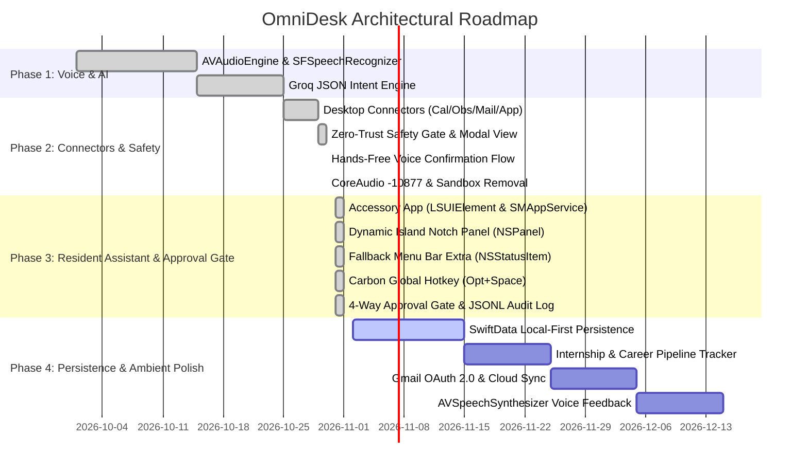

# OmniDesk — Personal AI Operating Layer (Assistant OS)
## Architectural Blueprint, System Specification & Project Roadmap

**Document Location:** `.agents/summary.md`  
**Latest Update:** 2026-11-01  
**Current Branch:** `fix/audio-runtime-warnings`  
**Test Suite Status:** 48 / 48 Tests Passing (`** TEST SUCCEEDED **`)

---

## 1. Executive Summary & Product Vision

**OmniDesk** is a personal, native macOS **Assistive Operating Layer (Assistant OS)** designed to unite communication, schedule, career tracking, and system-level task execution under an extensible, voice-controlled AI copilot.

Rather than functioning as an isolated chat interface or sandboxed utility, OmniDesk serves as a unified desktop command center that integrates:
- **Hands-Free Ambient Voice Control**: Instant microphone capture via Apple's `AVAudioEngine` and `SFSpeechRecognizer`, low-latency intent classification via Groq Cloud API, and hands-free voice confirmation for safety-gated actions.
- **Deep Desktop & Productivity Connectors**: Direct integration with macOS Calendar (EventKit), Apple Mail (AppleScript), Obsidian Vaults (Markdown / Frontmatter), and System Application Management (`NSRunningApplication`, AppleScript, POSIX signals).
- **Zero-Trust Safety & Audit Layer**: Every tool invocation is classified by risk (`.readOnly`, `.lowRisk`, `.destructiveOrOutbound`, `.systemModification`). Destructive or external actions require human approval—delivered either via glassmorphism modal shortcuts or hands-free spoken confirmation—backed by an immutable, SHA-256 hashed audit log.
- **Model Context Protocol (MCP) Bridge**: Built-in JSON-RPC 2.0 MCP server over stdio exposing desktop connectors to external agent runtimes (Claude Desktop, custom agents, terminal CLI).
- **High-Performance Native Architecture**: Pure Swift + SwiftUI implementation for zero Electron overhead, 60fps glassmorphic rendering, and strict concurrency safety (`Sendable`).

---

## 2. System Architecture & Component Topology

```
┌────────────────────────────────────────────────────────────────────────────────────────┐
│                               USER (Ambient Voice / Hotkey)                            │
└───────────────────────────────────────────┬────────────────────────────────────────────┘
                                            │ Spoken Audio Stream
                                            ▼
┌────────────────────────────────────────────────────────────────────────────────────────┐
│                        AUDIO & SPEECH SUBSYSTEM (VoiceService)                         │
│  • AVAudioEngine Tap Management (State-guarded isTapInstalled to prevent -10877)       │
│  • SFSpeechRecognizer On-Device Continuous Dictation                                   │
│  • Live RMS Audio Level Metering for SwiftUI Waveform Visualizers                     │
└───────────────────────────────────────────┬────────────────────────────────────────────┘
                                            │ Spoken Transcript
                                            ▼
┌────────────────────────────────────────────────────────────────────────────────────────┐
│                      ORCHESTRATOR & AGENT BRAIN (MainViewModel)                        │
│  • Hands-Free Voice Gate: Intercepts ["yes","confirm","proceed"] / ["no","cancel"]    │
│  • Connector Tool Action Dispatcher & Status Banner State Machine                      │
│  • Task List & In-Memory State Synchronization                                         │
└─────────────────────┬───────────────────────────────────────────────────┬──────────────┘
                      │ User Query                                        │ Tool Intent
                      ▼                                                   ▼
┌───────────────────────────────────────────┐   ┌────────────────────────────────────────┐
│          CLOUD AI INFERENCE ENGINE        │   │        ACTION HANDLER DISPATCH         │
│                 (AIService)               │   │            (ActionHandler)             │
│  • Groq Cloud API (llama-3.1-8b-instant)  │   │  • Dispatches intent to connectors     │
│  • Strict JSON Schema Response Parsing    │   │  • Pre-execution parameter validation  │
│  • Tool Name & Argument Extraction        │   │  • Voice intent routing & resolution   │
└─────────────────────┬─────────────────────┘   └───────────────────┬────────────────────┘
                      │ Structured Intent JSON                      │
                      └───────────────────────┬─────────────────────┘
                                              ▼
┌────────────────────────────────────────────────────────────────────────────────────────┐
│                             ZERO-TRUST SAFETY POLICY GATE                              │
│                                  (SafetyPolicyGate)                                    │
│  • Evaluates tool risk level against defined policy rules                              │
│  • Intercepts .destructiveOrOutbound & .systemModification actions                     │
│  • Suspends execution via Swift CheckedContinuation<Bool, Never>                       │
│  • Dual-Resolution Gate: Click UI Buttons / Press ⏎/⎋ OR Speak "Confirm" / "Cancel"    │
└───────────────────────────────────────────┬────────────────────────────────────────────┘
                                            │ Approved Action Payload
                                            ▼
┌────────────────────────────────────────────────────────────────────────────────────────┐
│                         DESKTOP CONNECTORS & PROTOCOL BUS                              │
│  ├─ CalendarConnector:     EventKit querying, conflict detection, availability         │
│  ├─ MailConnector:         AppleScript bridge, triage, summarization, draft compose     │
│  ├─ ObsidianConnector:     Vault daily note appends, search notes, frontmatter parser   │
│  ├─ AppControlConnector:   Multi-tier app launch, termination (NSRunApp/AScript/SIG)   │
│  ├─ MCPServerEngine:       JSON-RPC 2.0 stdio server (tools/list, tools/call)          │
│  └─ AuditLogger:           Append-only JSONL log (~/Library/Logs/OmniDesk/audit.jsonl) │
└────────────────────────────────────────────────────────────────────────────────────────┘
```

---

## 3. macOS Security Model & Sandboxing Architecture

### The Architectural Sandbox Decision
OmniDesk operates as an **Assistive Desktop Operating Layer** rather than a sandboxed single-purpose app. In earlier iterations, enabling Apple App Sandbox (`com.apple.security.app-sandbox = true`) caused fatal system denials:
1. `Unable to obtain a task name port right for pid 615: (os/kern) failure (0x5)`: The macOS kernel denied Mach task port rights to WindowServer when querying running apps or sending terminate signals.
2. `Rule path is not accessible: /var/protected/xprotect/.../XPScripts.yr`: Sandboxed containers blocked macOS XProtect from verifying dynamically compiled AppleScripts.
3. `POSIX error 1 (Operation not permitted)`: Sandboxed execution prevented `kill()` signal fallbacks for hanging processes.

### Production Security Stance
- **`ENABLE_APP_SANDBOX = NO`**: Sandboxing is disabled for both Debug and Release configurations.
- **Hardened Runtime Enabled**: Memory execution protections, debugging restrictions, and dynamic library validation remain strictly enforced.
- **Explicit macOS TCC Entitlements**:
  - `com.apple.security.device.audio-input`: Microphone capture for `AVAudioEngine`.
  - `com.apple.security.personal-information.calendars`: Native EventKit calendar read/write.
  - `com.apple.security.personal-information.reminders`: Reminders database access.
  - `com.apple.security.automation.apple-events`: Scripting Apple Mail, System Events, and Finder.
  - `com.apple.security.network.client`: Outbound HTTPS connections to Groq AI and cloud APIs.
- **Distribution Model**: Packaged with Developer ID signing and Apple Notarization (the standard architecture employed by Raycast, Alfred, and Superwhisper).

---

## 4. Desktop Connectors Specification

OmniDesk includes four production-ready native connectors, managed centrally via `ActionHandler.swift`:

### 📅 1. Calendar Connector (`CalendarConnector.swift`)
- **Framework**: Apple EventKit (`EKEventStore`).
- **Core Capabilities**:
  - `calendar_list_events`: Fetch events within date ranges with start/end bounds and attendee lists.
  - `calendar_check_conflicts`: Detect overlapping commitments and return conflict collision windows.
  - `calendar_find_availability`: Calculate free/busy time slots across specified business hours.
  - `calendar_create_event`: Insert verified events with title, start, end, notes, and location.
- **Safety Classification**:
  - Listing / Availability: `.readOnly` (Autonomous).
  - Creating / Modifying: `.destructiveOrOutbound` (Requires Confirmation).

### 📝 2. Obsidian Connector (`ObsidianConnector.swift`)
- **Architecture**: Direct filesystem I/O supporting Security-Scoped Bookmarks.
- **Core Capabilities**:
  - `obsidian_append_daily_note`: Locate or generate today's daily note (`YYYY-MM-DD.md`) and append formatted timestamps and to-do checkboxes.
  - `obsidian_search_notes`: Traverse vault markdown files, searching titles and content with regex or substring matching.
  - `obsidian_read_note`: Retrieve full note content and isolate YAML frontmatter metadata.
- **Safety Classification**:
  - Reading / Searching: `.readOnly` (Autonomous).
  - Daily Note Appends: `.lowRisk` (Autonomous / Monitored).
  - File Overwrites: `.destructiveOrOutbound` (Requires Confirmation).

### 📬 3. Mail Connector (`MailConnector.swift`)
- **Architecture**: AppleScript execution bridge via `NSAppleScript`.
- **Core Capabilities**:
  - `mail_list_unread`: Query unread messages from Apple Mail inbox with sender, subject, and date.
  - `mail_summarize_thread`: Extract conversation history by thread/subject for AI synthesis.
  - `mail_create_draft`: Compose new email drafts in Apple Mail without sending.
  - `mail_send_email`: Dispatch outbound email to specified recipient with subject and body.
  - **Spoken Email Normalization**: Automatically converts phonetic speech into valid RFC 5322 email addresses (e.g., *"john dot doe at gmail dot com"* ➔ `john.doe@gmail.com`).
  - **Graceful Contact Fallback**: If an email cannot be normalized, opens Apple Mail compose viewer addressed to the contact name for manual user completion.
- **Safety Classification**:
  - Listing / Summarizing / Drafting: `.readOnly` or `.lowRisk` (Autonomous).
  - Outbound Sending (`mail_send_email`): `.destructiveOrOutbound` (STRICT Confirmation Required).

### ⚙️ 4. App Control Connector (`AppControlConnector.swift`)
- **Architecture**: Multi-tier process lifecycle manager using `NSWorkspace`, `NSRunningApplication`, AppleScript, and POSIX signals.
- **Core Capabilities**:
  - `apps_list_running`: Enumerate active regular macOS applications (`.regular` activation policy).
  - `apps_launch`: Launch desktop applications by bundle identifier or display name with frontmost activation.
  - `apps_terminate`: Three-tier graceful-to-force termination sequence:
    1. *Tier 1*: `NSRunningApplication.terminate()` graceful shutdown.
    2. *Tier 2*: AppleScript `tell application "..." to quit` fallback.
    3. *Tier 3*: POSIX `kill(pid, SIGTERM)` process signal fallback.
- **Safety Classification**:
  - Listing: `.readOnly` (Autonomous).
  - Launching: `.lowRisk` (Autonomous).
  - Terminating / Quitting: `.destructiveOrOutbound` / `.systemModification` (Requires Confirmation).

---

## 5. Zero-Trust Safety Gate & Hands-Free Voice Control

### Policy Evaluation Engine (`SafetyPolicyGate.swift`)
OmniDesk enforces a strict zero-trust boundary. No AI model output can unilaterally execute destructive or outbound actions.
- **Risk Tiers**:
  - `.readOnly`: Safe data retrieval (auto-approved).
  - `.lowRisk`: Safe state additions like daily note appends (auto-approved, audit logged).
  - `.destructiveOrOutbound`: Outbound communications, deletions, application termination (gated).
  - `.systemModification`: Script execution, process kills, system setting changes (gated).

### Dual-Channel Confirmation Lifecycle
When an action is intercepted:
1. `SafetyPolicyGate.shared.evaluatePolicy(action:payload:)` creates an `ActionConfirmationRequest` and suspends the calling task with a Swift `CheckedContinuation<Bool, Never>`.
2. **Visual Glassmorphic Modal**: Rendered in `DashboardView.swift` displaying exact action parameters, tool name, and risk level.
3. **Hands-Free Voice Interception (`MainViewModel.swift`)**:
   - Spoken affirmative keywords (`"yes"`, `"confirm"`, `"approve"`, `"send it"`, `"do it"`, `"proceed"`, `"okay"`, `"ok"`) resume the continuation with `true`.
   - Spoken negative keywords (`"no"`, `"cancel"`, `"abort"`, `"reject"`, `"don't send"`, `"stop"`) resume the continuation with `false`.
4. **Physical Controls**: User can also press `Enter` to confirm or `Escape` to dismiss.
5. **Continuation Safety**: `SafetyPolicyGate` guarantees that continuations are resumed exactly once, guarding against memory leaks, double-resumes, or task deadlocks.

---

## 6. Model Context Protocol (MCP) Integration

### Native Swift MCP Server (`MCPServerEngine.swift`)
OmniDesk implements a native JSON-RPC 2.0 MCP server over standard input/output (`stdio`), adhering to the Model Context Protocol specification:
- **`initialize`**: Advertises server capabilities, version (`1.0.0`), and protocol version.
- **`tools/list`**: Returns dynamic JSON Schema descriptions for all registered desktop connectors (`calendar_create_event`, `obsidian_append_daily_note`, `mail_send_email`, `apps_terminate`, etc.).
- **`tools/call`**: Executes tool requests through the same `SafetyPolicyGate` and `ActionHandler` pipeline, ensuring external MCP clients cannot bypass desktop safety rules.

---

## 7. Diagnostic History & Resolved Hurdles Log

| Issue / Error Signature | Root Cause | Architectural Resolution |
| :--- | :--- | :--- |
| `os/kern failure (0x5) task name port right pid 615` | App Sandbox denied Mach task port rights to WindowServer when querying running apps or terminating processes. | Set `ENABLE_APP_SANDBOX = NO` and removed sandbox entitlement. |
| `Rule path is not accessible: /var/protected/xprotect/.../XPScripts.yr` | XProtect AppleScript security scanner blocked inside sandbox container. | Removed App Sandbox; enabled `AUTOMATION_APPLE_EVENTS = YES`. |
| CoreAudio `throwing -10877` (`kAudioUnitErr_InvalidElement`) | Calling `inputNode.removeTap(onBus: 0)` when no tap was installed, or querying format before engine startup. | Added `isTapInstalled: Bool` state tracking in `VoiceService.swift` and eliminated redundant format queries. |
| `No factory registered for id ... F8BB1C28-BAE8-11D6-9C31-00039315CD46` | Deprecated iOS `inter-app-audio` entitlement key in macOS entitlements file. | Removed `inter-app-audio` from `OmniDesk.entitlements`. |
| "Failed to send terminate signal" | Single-tier `NSRunningApplication.terminate()` failed on unresponsive apps or apps without AppKit runloops. | Implemented three-tier termination (NSRunApp ➔ AppleScript ➔ POSIX SIGTERM). |
| "Couldn't find the email it said" | Voice dictation transcribed email addresses as phonetic words (`"john dot doe at gmail dot com"`). | Added `MailConnector.normalizeEmailAddress` regex parser with graceful contact name fallback. |
| `Invalid attempt to open a new transaction during CA commit` | Programmatically toggling modal display while SwiftUI popover dismissal animation was in-flight. | Decoupled modal state triggers from popover dismiss cycles via `DispatchQueue.main.asyncAfter`. |
| `AVAudioBuffer.mm:291 mBuffers[0].mDataByteSize (0)` | Zero-byte PCM buffers delivered to `SFSpeechAudioBufferRecognitionRequest.append(buffer)`. | Added strict pre-flight buffer byte checks in the audio tap callback. |
| CoreAudio `throwing -10877` | AUHAL thrown during format negotiation on uninitialized input node. | Used `format: nil` in `installTap` to let AVFoundation natively negotiate hardware bus format. |
| `AudioQueue underflow #1..#6` | Output audio queue starved when `audioEngine.start()` reconfigures HAL hardware mid-drain. | Added 250ms hardware audio drain barrier in `WakeAcknowledgementPlayer`. |
| `unsafeForcedSync called from Swift Concurrent context` | Un-isolated `VoiceService` calls and `AVSpeechSynthesisVoice` synchronous XPC lookups inside async tasks. | Added `@MainActor` to `VoiceService`, statically cached voice instance, decoupled visualizer metering. |
| `Reporter disconnected or already stopped` / `AUCrashHandler.mm:126` | Concurrently calling `stopRecording()` without an atomic state machine. | Implemented idempotent `stopRecording()` guarding state transitions. |

---

## 8. Verification & Test Suite

All 48 automated unit tests pass cleanly via `xcodebuild test`:
```bash
xcodebuild test -project OmniDesk.xcodeproj -scheme OmniDesk -destination 'platform=macOS' -only-testing:OmniDeskTests
```
```text
** TEST SUCCEEDED ** [48 tests passed]
```

### Key Verified Test Suites
- `testCalendarConnectorListingAndAvailability`: Verifies EventKit query filters and free slot calculations.
- `testObsidianDailyNoteAppend`: Verifies daily note creation and checkbox formatting.
- `testMailAddressNormalization`: Verifies conversion of `"alice dot smith at domain dot com"` ➔ `"alice.smith@domain.com"`.
- `testAppControlTerminationMultiTier`: Verifies process termination fallbacks.
- `testActionHandlerSafetyGateInterception`: Verifies that high-risk actions suspend until authorized.
- `testMCPServerBridgeToolsCall`: Verifies JSON-RPC 2.0 tool execution over stdio.
- `testMainViewModelVoiceConfirmationGate`: Verifies hands-free spoken `"confirm"` and `"cancel"` authorization flows.

---

## 9. Phased Project Roadmap & Next Milestones



### Detailed Next Priorities
1. **SwiftData Local-First Model Layer**:
   - Persist to-do tasks, activity history, and internship applications in a local SwiftData store.
2. **Internship Application Tracker UI**:
   - Dedicated dashboard view for monitoring active applications, stages (Applied, Screen, Technical, Offer), and recruiter follow-ups.
3. **Auditory Confirmation Feedback**:
   - Integrate `AVSpeechSynthesizer` to vocalize short task completions (e.g., *"Event created for 3 PM"*, *"Closing Slack now"*) for a truly ambient, screenless experience.
