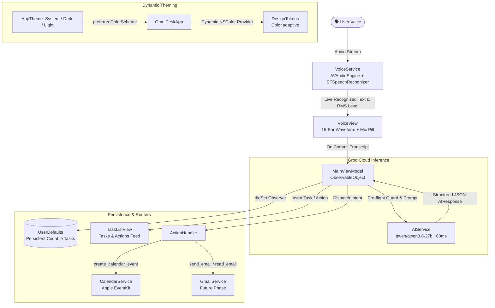

# OmniDesk 🎙️🖥️

> **Voice-Controlled Universal macOS Assistant**  
> An intelligent, hands-free desktop companion built with Swift and SwiftUI to control macOS workflows, schedule events, manage tasks, and automate everyday system operations through natural voice interaction.

---

## 📌 Project Overview

**OmniDesk** is designed to become a system-level assistant for macOS that automates workflows and manages your daily productivity entirely through voice commands. 

### 🚀 Current State (Phase 1 & Phase 2: Active Voice Pipeline & Minimalist OS Dashboard)
The core voice capture, cloud intelligence, task persistence, and adaptive UI design are fully functional:

1. **Audio Streaming & Speech Recognition**:
   - Real-time microphone capture via `AVAudioEngine` with RMS audio level metering.
   - Live speech-to-text transcription powered by Apple's native `SFSpeechRecognizer`.
   - Ultra-slim 15-bar dynamic waveform visualizer responding in real-time to speech amplitude.

2. **Ultra-Low Latency AI Intent Classification**:
   - Direct integration with **Groq Cloud API** running `qwen/qwen3.8-27b`.
   - Structured JSON schema output extracting intents (`create_task`, `create_calendar_event`) with clean titles and date/time metadata.
   - Average cloud roundtrip latency of ~60–80ms.
   - Built-in zero-latency local fast-paths (e.g., *"clear all tasks"*).
   - Resilient fallback: Even if offline or during network interruptions, spoken words are never discarded and are saved directly as tasks.

3. **Persistent Task & Action Management**:
   - Conformed `TodoTask` to `Codable` with automatic `UserDefaults` disk persistence.
   - All voice intents (tasks, reminders, calendar entries) are immediately saved to the active task list.
   - Fast manual task entry (`Add task manually...` with `↵` key).
   - Task completion toggles, hover-to-delete, and date/time chip badges.

4. **Linear / Raycast Style Minimalist UI & Theming**:
   - Deep obsidian dark mode (`#14171C` / `#1E2129`) with crisp 1px borders.
   - Dynamic Light / Dark / System appearance customization:
     - **System (Default)**: Automatically tracks macOS appearance (`.aqua` / `.darkAqua`).
     - **Dark**: High-contrast obsidian dark mode.
     - **Light**: Crisp slate-and-white theme (`#F5F7FA` with `#FFFFFF` cards).
   - Dedicated in-app **Quick Settings popover** (`gearshape`) and standard macOS **Settings Window** (`Cmd + ,`).

5. **Antigravity Customizations & Slash Commands**:
   - `voice-task-pipeline`: Engineering skill for real-time audio metering, speech recognition, and Groq inference.
   - `/compact`: Custom slash command and standalone Python script (`summarize_conversation.py`) that analyzes Antigravity conversation transcripts and compiles structured markdown logs.

---

## 🏗️ Architecture & Data Flow



---

## 📁 Repository File Report

Below is the complete file-by-file audit of the repository, including current implementation status and technical responsibilities.

### 1. Root Configuration & Secrets
| File | Status | Description |
| :--- | :---: | :--- |
| [`Secrets.xcconfig`](Secrets.xcconfig) | **Active (Local Only)** | Holds local sensitive keys (`GROQ_API_KEY`). Excluded from Git via `.gitignore`. |
| [`Secrets.template.xcconfig`](Secrets.template.xcconfig) | **Active** | Version-controlled template showing required configuration keys. |
| [`.gitignore`](.gitignore) | **Active** | Ignores `.xcconfig` secrets, build artifacts, and local session summaries. |
| [`conversation_summary.md`](conversation_summary.md) | **Active** | Session archive generated via `/compact`. |

---

### 2. Application Entry & State Management
| File | Status | Description |
| :--- | :---: | :--- |
| [`App/OmniDeskApp.swift`](App/OmniDeskApp.swift) | **Active** | App entrypoint (`@main`). Configures `WindowGroup` with `.hiddenTitleBar`, `.preferredColorScheme`, and native macOS `Settings { SettingsView() }`. |
| [`ViewModels/MainViewModel.swift`](ViewModels/MainViewModel.swift) | **Active** | Core presentation logic. Manages `@Published var tasks: [TodoTask]` with automatic `UserDefaults` disk persistence, coordinates `AIService`, and dispatches to `ActionHandler`. |

---

### 3. Data Models
| File | Status | Description |
| :--- | :---: | :--- |
| [`Models/Task.swift`](Models/Task.swift) | **Active** | `TodoTask` struct conforming to `Identifiable`, `Equatable`, and `Codable` (`id`, `title`, `date`, `time`, `isCompleted`, `createdAt`). |
| [`Models/AIResponse.swift`](Models/AIResponse.swift) | **Active** | `Codable` model matching the Groq LLM JSON schema (`intent`, `title`, `date`, `time`). |

---

### 4. UI Layer (Views) & Design Tokens
| File | Status | Description |
| :--- | :---: | :--- |
| [`Views/DashboardView.swift`](Views/DashboardView.swift) | **Active** | Main macOS dashboard with header bar, status alert banners, footer shortcut legend, and embedded `SettingsView` popover. |
| [`Views/VoiceView.swift`](Views/VoiceView.swift) | **Active** | Voice interface featuring 15-bar RMS audio waveform visualizer, live transcription display, and record/process toggle button. |
| [`Views/TaskListView.swift`](Views/TaskListView.swift) | **Active** | Minimalist task management interface with counter badge, inline quick add, date/time chips, hover-to-delete, and strikethrough toggles. |
| [`Utilities/DesignTokens.swift`](Utilities/DesignTokens.swift) | **Active** | Design system: `AppTheme` enum (System, Dark, Light), `Color.adaptive(light:dark:)` tokens, `MinimalCardModifier`, and `KeyboardShortcutBadge`. |

---

### 5. Services & Action Routers
| File | Status | Description |
| :--- | :---: | :--- |
| [`Services/VoiceService.swift`](Services/VoiceService.swift) | **Active** | Manages `AVAudioEngine` tap, RMS power calculation, microphone permissions, and real-time speech transcription via `SFSpeechRecognizer`. |
| [`Services/AIService.swift`](Services/AIService.swift) | **Active** | Sends prompts to Groq Cloud chat completions using `qwen/qwen3.8-27b` with JSON schema enforcement. Multi-tier API key resolution. |
| [`Services/CalendarService.swift`](Services/CalendarService.swift) | **Active** | Integrates with macOS `EventKit` (`EKEventStore`) to schedule calendar events. |
| [`ActionRouters/ActionHandler.swift`](ActionRouters/ActionHandler.swift) | **Active** | Routes parsed `AIResponse` intents to system services. |
| [`Services/GmailService.swift`](Services/GmailService.swift) | **Pending** | Reserved for Google OAuth and Gmail API integration. |
| [`Utilities/Permissions.swift`](Utilities/Permissions.swift) | **Pending** | Reserved for centralized permission management. |

---

### 6. Antigravity Customizations & Skills
| Path | Scope | Description |
| :--- | :---: | :--- |
| [`.agents/skills/voice-task-pipeline/SKILL.md`](.agents/skills/voice-task-pipeline/SKILL.md) | Workspace | Technical runbook for audio buffer RMS metering, low-latency Groq prompts, and SwiftUI visualizers. |
| [`.agents/skills/compact/SKILL.md`](.agents/skills/compact/SKILL.md) | Workspace & Global | Defines the `/compact` slash command for compiling full session histories into markdown. |
| [`.agents/skills/compact/scripts/summarize_conversation.py`](.agents/skills/compact/scripts/summarize_conversation.py) | Workspace & Global | Executable Python script that parses `transcript.jsonl` into executive summaries. |

---

### 7. macOS Project Configuration & Security
| File | Status | Description |
| :--- | :---: | :--- |
| [`OmniDesk/Info.plist`](OmniDesk/Info.plist) | **Active** | Configures privacy strings: `NSMicrophoneUsageDescription`, `NSSpeechRecognitionUsageDescription`, `NSCalendarsUsageDescription`, and `GROQ_API_KEY` bundle binding. |
| [`OmniDesk/OmniDesk.entitlements`](OmniDesk/OmniDesk.entitlements) | **Active** | macOS sandbox entitlements: audio input (`com.apple.security.device.audio-input`), network client (`com.apple.security.network.client`), and calendar access (`com.apple.security.personal-information.calendars`). |
| [`OmniDesk.xcodeproj/project.pbxproj`](OmniDesk.xcodeproj/project.pbxproj) | **Active** | Xcode project build settings, target configurations, file references, and deployment settings (macOS 14+). |
| [`OmniDesk/Assets.xcassets`](OmniDesk/Assets.xcassets) | **Active** | Asset catalog holding AppIcon and AccentColor sets. |

---

### 8. Test Suites
| File | Status | Description |
| :--- | :---: | :--- |
| [`OmniDeskTests/OmniDeskTests.swift`](OmniDeskTests/OmniDeskTests.swift) | **Active** | **8 passing unit tests**: Codable serialization, task persistence across instances, `AppTheme` colorScheme mapping, AI JSON decoding, local fast-path execution, model state toggling, and input validation. |
| [`OmniDeskUITests/OmniDeskUITests.swift`](OmniDeskUITests/OmniDeskUITests.swift) | **Active** | UI test harness using `XCTestCase` and `XCUIApplication`. |
| [`OmniDeskUITests/OmniDeskUITestsLaunchTests.swift`](OmniDeskUITests/OmniDeskUITestsLaunchTests.swift) | **Active** | UI launch and screenshot verification tests. |

---

## ⚙️ Setup & Configuration

### Prerequisites
- macOS 14.0 Sonoma or newer
- Xcode 15 or newer
- Groq Cloud API Key ([console.groq.com](https://console.groq.com))

### Installation
1. **Clone the repository**:
   ```bash
   git clone https://github.com/Dhruvil05Patel/OmniDesk.git
   cd OmniDesk
   ```

2. **Configure API Secrets**:
   Copy the template configuration file to `Secrets.xcconfig`:
   ```bash
   cp Secrets.template.xcconfig Secrets.xcconfig
   ```
   Open `Secrets.xcconfig` and insert your Groq API key:
   ```xcconfig
   GROQ_API_KEY = gsk_your_actual_groq_key_here
   ```

3. **Link `.xcconfig` in Xcode**:
   - Open `OmniDesk.xcodeproj` in Xcode.
   - Select the project root in the left navigator.
   - Under **Project** (OmniDesk) → **Info** tab → **Configurations**, expand **Debug** and **Release**.
   - Set the configuration for the `OmniDesk` target to `Secrets`.

4. **Run the App**:
   - Select the `OmniDesk` scheme and destination `My Mac`.
   - Press **Cmd + R** to build and run.
   - Grant **Microphone**, **Speech Recognition**, and **Calendar** permissions when prompted.

---

## ⌨️ Keyboard Shortcuts & Controls

| Shortcut | Context | Action |
| :--- | :--- | :--- |
| **Space** | Idle | Start Voice Dictation |
| **Esc** | Recording | Stop Recording & Process with Groq AI |
| **↵ (Return)** | Quick Add Field | Submit manual task |
| **Cmd + ,** | Anywhere | Open macOS Settings window |
| **/compact** | Antigravity Chat | Generate and archive full session summary as markdown |

---

## 🗺️ Roadmap & Upcoming Milestones

- [ ] **Accessibility / AppleScript Integration**: Grant macOS Accessibility permissions to control system applications (Finder, Safari, Notes, Mail).
- [ ] **Gmail Integration (`GmailService.swift`)**: Google OAuth 2.0 flow to fetch unread emails and draft responses by voice.
- [ ] **Menu Bar Daemon Mode**: Run OmniDesk as a lightweight menu bar status item with a global hotkey popup.
- [ ] **Voice Activation (Wake Word)**: On-device offline wake word detection (e.g., *"Hey OmniDesk"*).
