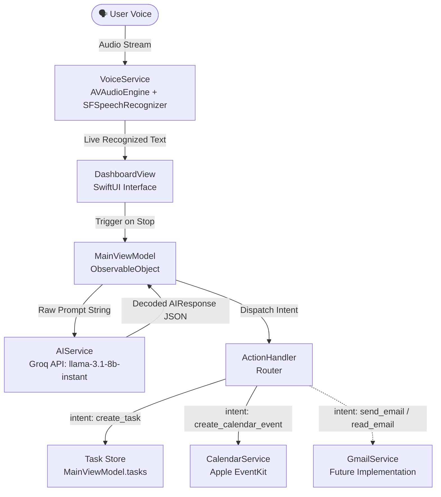

# OmniDesk 🎙️🖥️

> **Voice-Controlled Universal macOS Assistant**  
> An intelligent, hands-free desktop companion built with Swift and SwiftUI to control macOS workflows, schedule events, manage tasks, and automate everyday system operations through natural voice interaction.

---

## 📌 Project Overview

**OmniDesk** is designed to become a system-level assistant for macOS that can automate workflows and control applications entirely through voice commands. 

### 🚀 Current State (Phase 1: Voice & AI Pipeline)
Currently, the foundational **Voice-to-Text and AI Intent Classification** pipeline is implemented:
1. **Audio Streaming & Speech Recognition**: Captures live microphone audio using `AVAudioEngine` and converts it into real-time text via Apple's native `SFSpeechRecognizer`.
2. **AI Intent Extraction**: Sends transcribed text to the **Groq API** (running `llama-3.1-8b-instant`) to extract structured intents (`create_task`, `create_calendar_event`, `unknown`) along with parsed entities (`title`, `date`, `time`).
3. **Action Dispatching**: Routes parsed intents to corresponding service handlers (such as EventKit calendar event creation and in-memory task tracking).

---

## 🏗️ Architecture & Data Flow



---

## 📁 Repository File Report

Below is a complete file-by-file audit of the repository, including implementation status and technical responsibilities.

### 1. Root Configuration & Secrets
| File | Status | Description |
| :--- | :---: | :--- |
| [`Secrets.xcconfig`](Secrets.xcconfig) | **Active (Local Only)** | Contains local sensitive secrets (e.g., `GROQ_API_KEY`). Excluded from version control via `.gitignore`. |
| [`Secrets.template.xcconfig`](Secrets.template.xcconfig) | **Active** | Version-controlled template showing required environment keys for new contributors. |
| [`.gitignore`](.gitignore) | **Active** | Standard macOS/Xcode ignore rules with explicit ignores for `.xcconfig` secret files and build artifacts. |

---

### 2. Application Entry & State Management
| File | Status | Description |
| :--- | :---: | :--- |
| [`App/OmniDeskApp.swift`](App/OmniDeskApp.swift) | **Active** | Main entrypoint for the SwiftUI application (`@main`). Launches the primary `WindowGroup` with `DashboardView`. |
| [`ViewModels/MainViewModel.swift`](ViewModels/MainViewModel.swift) | **Active** | Core presentation logic. Manages published `@Published var tasks: [TodoTask]`, coordinates async calls to `AIService`, and triggers `ActionHandler`. |

---

### 3. Data Models
| File | Status | Description |
| :--- | :---: | :--- |
| [`Models/AIResponse.swift`](Models/AIResponse.swift) | **Active** | `Decodable` model matching the Groq LLM JSON output (`intent`, `title`, `date`, `time`). |
| [`Models/Task.swift`](Models/Task.swift) | **Active** | `TodoTask` struct conforming to `Identifiable` for representing extracted user tasks. |

---

### 4. UI Layer (Views)
| File | Status | Description |
| :--- | :---: | :--- |
| [`Views/DashboardView.swift`](Views/DashboardView.swift) | **Active** | Main control panel containing Start/Stop recording controls, live transcription text feed, and the current task list. |
| [`Views/VoiceView.swift`](Views/VoiceView.swift) | **Placeholder** | Stub view reserved for modular voice visualizer / audio wave component. |
| [`Views/TaskListView.swift`](Views/TaskListView.swift) | **Placeholder** | Stub view reserved for modular task management interface. |

---

### 5. Services & Action Routers
| File | Status | Description |
| :--- | :---: | :--- |
| [`Services/VoiceService.swift`](Services/VoiceService.swift) | **Active** | Manages `AVAudioEngine` audio input tap, microphone authorization, and real-time speech transcription via `SFSpeechRecognizer`. |
| [`Services/AIService.swift`](Services/AIService.swift) | **Active** | Sends voice transcripts to Groq's chat completions endpoint using `llama-3.1-8b-instant` with structured JSON output parsing. Reads API key securely from `Info.plist`. |
| [`Services/CalendarService.swift`](Services/CalendarService.swift) | **Active** | Integrates with macOS `EventKit` (`EKEventStore`) to request calendar permissions and write calendar events. |
| [`ActionRouters/ActionHandler.swift`](ActionRouters/ActionHandler.swift) | **Active** | Routes structured `AIResponse` intents to system services (`create_calendar_event` -> `CalendarService`, `create_task` -> Task list). |
| [`Services/GmailService.swift`](Services/GmailService.swift) | **Pending** | Empty file reserved for Google OAuth and Gmail API integration. |
| [`Services/AIService 2.swift`](Services/AIService%202.swift) | **Legacy / Duplicate** | Earlier prototype implementation with mock parser. Candidate for cleanup. |
| [`Services/Untitled.swift`](Services/Untitled.swift) | **Empty** | Unused placeholder file. |
| [`Utilities/Permissions.swift`](Utilities/Permissions.swift) | **Pending** | Reserved for centralized permission checks (Microphone, Speech Recognition, Calendar, Accessibility). |

---

### 6. macOS Project Configuration & Metadata
| File | Status | Description |
| :--- | :---: | :--- |
| [`OmniDesk/Info.plist`](OmniDesk/Info.plist) | **Active** | Configures macOS privacy permissions: `NSMicrophoneUsageDescription`, `NSSpeechRecognitionUsageDescription`, `NSCalendarsUsageDescription`, and `GROQ_API_KEY` mapping to `$(GROQ_API_KEY)`. |
| [`OmniDesk/OmniDesk.entitlements`](OmniDesk/OmniDesk.entitlements) | **Active** | Configures app sandbox capabilities including `inter-app-audio`. |
| [`OmniDesk.xcodeproj/project.pbxproj`](OmniDesk.xcodeproj/project.pbxproj) | **Active** | Xcode project build settings, target configurations, file references, and deployment settings (macOS 14+). |
| [`OmniDesk/Assets.xcassets`](OmniDesk/Assets.xcassets) | **Active** | Xcode Asset catalog holding AppIcon and AccentColor sets. |

---

### 7. Test Suites
| File | Status | Description |
| :--- | :---: | :--- |
| [`OmniDeskTests/OmniDeskTests.swift`](OmniDeskTests/OmniDeskTests.swift) | **Active** | Unit testing suite using Swift Testing (`@Test`). |
| [`OmniDeskUITests/OmniDeskUITests.swift`](OmniDeskUITests/OmniDeskUITests.swift) | **Active** | UI test harness using `XCTestCase` and `XCUIApplication`. |
| [`OmniDeskUITests/OmniDeskUITestsLaunchTests.swift`](OmniDeskUITests/OmniDeskUITestsLaunchTests.swift) | **Active** | UI launch and screenshot verification tests. |

---

## ⚙️ Setup & Configuration

### Prerequisites
- macOS 14.0 Sonoma or newer
- Xcode 15 or newer
- Groq Cloud API Key ([groq.com](https://console.groq.com))

### Installation
1. **Clone the repository**:
   ```bash
   git clone https://github.com/Dhruvil05Patel/OmniDesk.git
   cd OmniDesk
   ```

2. **Configure API Secrets**:
   Copy the template configuration file to `Secrets.xcconfig`:
   ```bash
   cp Secrets.template.xcconfig Secrets.xcconfig
   ```
   Open `Secrets.xcconfig` and insert your Groq API key:
   ```xcconfig
   GROQ_API_KEY = gsk_your_actual_groq_key_here
   ```

3. **Link `.xcconfig` in Xcode**:
   - Open `OmniDesk.xcodeproj` in Xcode.
   - Select the project root in the left navigator.
   - Select the **OmniDesk Project** (under *Project*, not *Targets*) → **Info** tab.
   - Under **Configurations**, expand **Debug** and **Release**.
   - Set the configuration for the OmniDesk target to `Secrets`.

4. **Run the App**:
   - Select `OmniDesk` target and `My Mac` as the destination.
   - Press **Cmd + R** to build and run.
   - Grant **Microphone**, **Speech Recognition**, and **Calendar** permissions when prompted.

---

## 🗺️ Roadmap & Upcoming Milestones

- [ ] **Codebase Cleanup**: Remove deprecated duplicate prototypes (`AIService 2.swift`, `Untitled.swift`).
- [ ] **Accessibility / AppleScript Integration**: Grant macOS Accessibility permissions to interact with native macOS apps (Finder, Safari, Notes, Mail).
- [ ] **Gmail Integration (`GmailService.swift`)**: Authenticate via Google OAuth to fetch unread emails and draft responses by voice.
- [ ] **Date & Time Parsing Improvements**: Replace current rough date handling in `CalendarService` with accurate ISO8601 formatting from AI responses.
- [ ] **Menu Bar Mode**: Run OmniDesk as a menu bar / status item daemon for instant hotkey activation from anywhere in macOS.
- [ ] **Voice Activation (Wake Word)**: On-device hotword listener (e.g. "Hey OmniDesk") for hands-free invocation without clicking buttons.
